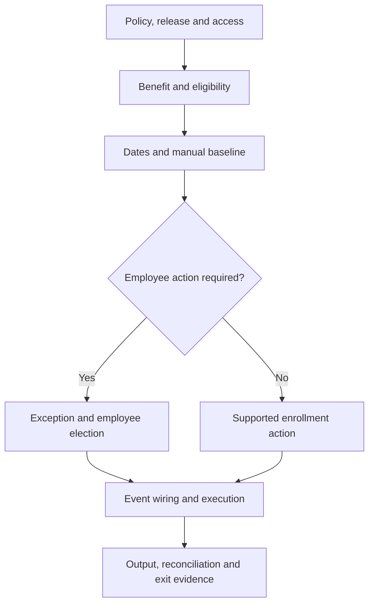

# Global Benefits Configuration Sequence Engine

## 1. The promise and the boundary

**Configure, test and explain one end-to-end, event-driven transport allowance scenario in a prepared SAP SuccessFactors sandbox, producing evidence that another consultant can follow. Finish within 21 hours; experienced consultants may demonstrate the same scoped outcome in 3 hours.**

This is a Realize-phase implementation bootcamp and a reusable source template. It turns topic-based SAP guidance into a dependency-based build sequence. It is a manual playbook and specification for a future sequence engine, not a deployed application or an automated tenant configurator.

The capstone covers one legal entity, one currency, one allowance, employee election outside open enrollment, and an employment-event path. It includes a manual exception baseline before automation, effective-date controls, employee permissions, operational evidence and a payroll handoff check. An optional personal-life-event contrast uses an existing insurance benefit; building an entire insurance product is outside scope.

**A 3-hour demonstration is credible only when prerequisites, relevant tenant access, test data, supported automation and payroll handoff facilities already exist.** Neither route represents a complete multinational implementation, certification of consultant competence, or proof of production readiness. Without a working tenant, submit a design simulation clearly labelled `Designed—not executed`; it does not earn the hands-on completion result.

## 2. Analysis of the proposed qualifying-event explanation

| Statement | Implementation interpretation |
| --- | --- |
| Qualifying events are life/work events | Useful business language. Map the policy event to the actual SAP event objects and processing mechanism in the selected release. A policy label alone does not publish a system event. |
| Every life/work event triggers an exception | Too broad. Decide whether to create, update or end an enrollment, open an employee election exception, or take no action. SAP supports action-based event configuration [S02]. |
| An exception changes eligibility | Do not assume this. An election window and the employee's entitlement are separate controls. Explicitly test eligibility and any approved administrator override. |
| Transfer/grade change always triggers ISC | Too broad. Confirm which system event, subscriber, determination rule and change conditions are supported in the tenant. A saved EC change is not evidence of successful benefits processing [S03]. |
| Marriage/birth affects transport allowance | Only if the employer's documented policy says so. In this capstone they do not. Use those events as a negative test for transport and a contrast for dependent insurance. |
| Allowances are deductions | Ordinary allowance enrollment is compensation-based under pay-component integration. Deductible Allowance is a separate benefit type. Select the correct integration mode and output object [S08]. |
| An exception always sends email | Configuration and delivery must be tested. Exception notices, workflow notices and enrollment-confirmation emails are separate outcomes. Never use inbox receipt as the only evidence of an exception [S09, S10]. |
| Marriage automatically prorates every savings plan | Product-, plan-, country- and release-dependent. Do not transfer savings-plan behavior to transport allowances. No savings-plan proration is claimed or configured here. |
| Adjustment Amount is a universal life-event action | Treat entitlement/amount exceptions separately from enrollment actions. Confirm the applicable benefit type and supported exception values; do not invent a universal dropdown option. |

**Core mental model:** policy event → supported trigger → event determination → benefit event configuration → eligibility and date evaluation → enrollment action or exception → employee/approver action where required → compensation/payroll handoff → reconciliation.

## 3. Learning-journey alignment

The attached `SuccessLabs_Academy_2640_Learning_Journeys.xlsx` contains 2,640 data rows with 2,640 unique LJ-IDs: **11 sectors × 12 streams × 20 tracks**. It is a catalogue, not a supplied configuration-manual template. Its columns are LJ-ID, Sector, Stream, Track, Sector Code, Stream Code, Track Code and Status. No workbook rows or statuses were changed.

Use the workbook's codes as authoritative: this bootcamp's primary row is **ENE-APP-IMP**. Retain `APP` even when the learner-facing title is “Application & Process Architect”; retain `INF` when displaying “Cloud & Infrastructure Architect.” `IIL / Build` is a delivery-lab label, not a replacement for the workbook's `IMP` track code. Sector examples are illustrative and portable; they do not create new catalogue rows.

| Architecture lens | Existing Energy journey | Contribution within this bootcamp |
| --- | --- | --- |
| Enterprise Architect | ENE-EA-IMP | Explain value, ownership and the Realize exit decision. |
| Business Architect | ENE-BA-IMP | Translate transport policy into decisions and employee outcomes. |
| Data Architect | ENE-DA-IMP | Trace legal entity, location, grade and effective dates. |
| Application & Process Architect | ENE-APP-IMP | Own the configuration chain and dependency order. |
| Technology Architect | ENE-TECH-IMP | Check release and supported execution mechanisms. |
| AI Architect | ENE-AI-IMP | Use AI to challenge test coverage; verify suggestions in SAP. |
| Security Architect | ENE-SEC-IMP | Prove employee/admin permissions and target populations. |
| UI/UX Architect | ENE-UX-IMP | Test understandable dates, actions and employee messages. |
| Cloud & Infrastructure Architect | ENE-INF-IMP | Check environment, access, outbound mail and monitoring dependencies. |
| Integration Architect | ENE-INT-IMP | Trace allowance output and payroll reconciliation. |
| Domain Architect | ENE-DOM-IMP | Separate eligibility, entitlement, election and payment. |
| Industry Architect | ENE-INDU-IMP | Evaluate remote-site mobility and equitable access for energy workers. |

Learners choose one primary lens and review other lenses through the same build. Do not multiply the workload into twelve implementations. The existing twenty catalogue tracks remain intact; this bootcamp primarily serves Implementation, with Quality Assurance, Integration and AMS evidence embedded. It is not twenty separate tracks squeezed into 21 hours. BAISI PAHACHA™ mapping can be added using its approved theme register; no replacement theme names are invented here.

## 4. Timebox and adaptive routes

### Guided route: three days, seven hours per day

Each day has seven configuration cards × 45 minutes = 315 minutes. Add 30 minutes of shared review, 45 minutes of paired integration/retest, and 30 minutes of breaks = **420 minutes**. Three days = **1,260 minutes / 21 hours**, including breaks. Preparation checks are inside the timebox; access provisioning that cannot be completed there is a blocker, not hidden homework.

| Day | Cards | Shared review: 30 min | Integration/retest: 45 min | Breaks | Total |
| --- | --- | --- | --- | --- | --- |
| 1: Establish and build | C01–C07: 315 min | Policy and dependency review | Recheck baseline benefit and eligibility | 30 min | 420 min |
| 2: Connect events | C08–C14: 315 min | Date and event reasoning | Trace one event across objects and logs | 30 min | 420 min |
| 3: Prove and hand over | C15–C21: 315 min | Explain results and defects | Close high-impact failures and repeat critical flow | 30 min | 420 min |

Inside a 45-minute card: 5 minutes retrieve/predict, 5 inspect the relevant SAP reference, 20 configure, 10 test, 5 record evidence. A card can be verified early; use saved time for a failing scenario. At the cap, record incomplete work and the exact blocker. Do not silently extend the bootcamp.

### Expert route: three hours total

This is a challenge route, not accelerated reading of every page. Reuse and verify existing objects; do not rebuild a functioning tenant merely to generate activity.

| Minutes | Task | Required proof |
| --- | --- | --- |
| 0–15 | C01–C03: entry check and policy decision | Release, permissions, policy and dependency baseline |
| 15–45 | C04–C07: inspect/build allowance and eligibility | Positive and negative employee results |
| 45–75 | C08–C10: dates, manual exception and event definition | Working out-of-window employee election |
| 75–115 | C11–C14: wire and test the supported event route | Trigger-to-result log trace; no duplicate processing |
| 115–140 | C15–C17: approval, communication and payroll handoff | Observed lifecycle state and reconciled output |
| 140–170 | C18–C20: run the acceptance pack and handover | All mandatory assertions evidenced or marked blocked |
| 170–180 | C21: independent explanation and exit decision | Five-minute demo plus concise decision record |

If event wiring, debugging or prerequisites exceed the expert budget, switch to the remaining guided time allowance. **Total learning time across both routes must remain ≤21 hours.** Passing is based on evidence, not speed. Three-hour completion is possible, not promised.

## 5. Entry gate and release contract

- Use a sandbox/test tenant and synthetic employees. Identify tenant, environment, actual release and enabled Benefits UI before configuration.
- Record the exact SAP documentation version selected in Help Portal. Research on 21 October 2026 surfaced both 1H 2026 and 2H 2026 pages. A page labelled LATEST or a published release note does not prove the feature is active in this tenant.
- Verify EC core, required Benefits/MDF capabilities, Benefits Admin Overview, Configure Business Rules, object access, ISC access where used, and employee Benefits UI. Record actual enabled settings; route privileged enablement to the authorized owner rather than inventing an Admin Center switch [S11].
- Check legal entity, location, grade, currency, event reasons and employee job records. Ensure prerequisite records exist as of each test's effective date.
- Confirm configuration-admin, employee, approver and integration-test roles. Verify target populations, not just permission labels.
- Confirm a test outbound-mail route, optional workflow approver and one payroll handoff validation method. Do not substitute a spreadsheet for an observed integration result without labelling it a simulation.
- Inspect existing automatic-enrollment jobs and ISC flows to avoid overlapping processing. Capture a baseline before editing shared objects.
- Freeze one supported event-automation route for the capstone. A feature unavailable in the selected release becomes a recorded gap; do not fabricate success through manual record creation.

**Gate:** begin tenant execution only when the minimum sandbox path is available. If blocked, spend the allocated time on the policy/design artifacts, label the result as a design simulation, and leave execution status unverified.

## 6. Illustrative policy and test data

All company attributes, IDs, values and dates below are **training assumptions**, not confirmed OmniVerse facts, SAP defaults or statutory rules. This example uses an Energy enterprise context but deliberately limits scope to one India legal entity.

| Policy field | Training value |
| --- | --- |
| Legal entity | `SL_IN01` — fictional India entity |
| Benefit | `SL_GB_TRANSPORT_IN` — Transport Allowance |
| Currency/frequency | INR, monthly |
| Eligible employee | Active employee in SL_IN01, location SL_SITE_A, grade G5 or G6 |
| Entitlement | G5: ₹3,000/month; G6: ₹5,000/month; other populations ineligible |
| Employee election | Required for the baseline path; approval only if configured in the agreed scenario |
| Annual election window | 1–15 January 2026; enrollment period 1 January–31 December 2026 |
| Qualifying work event | Hire or transfer into the eligible population after the annual election window |
| Exception start/end | Event date E through E+29 calendar days, both dates included: 30 days |
| Enrollment effective date | Event date E, subject to successful election and applicable approval processing |
| Payment-effective policy | First day of the month after E, deliberately distinct from enrollment effective date |
| Loss of eligibility | End entitlement per approved effective-date policy; do not assume granting an exception ends payment |
| Marriage/birth | No transport entitlement change in this case |
| Payroll mode | Pay Components for this exercise; confirm tenant support and mappings before use |
| Proration | Not implemented by this lab; payroll owner must define production treatment |

**Date oracle:** E = 10 June 2026; exception window = 10 June–9 July 2026; enrollment effective = 10 June; intended allowance payment-effective = 1 July. In a test tenant use an appropriate controllable test date or shift the whole scenario to a currently executable date and recompute expected values. Do not expect an expired June window to be usable in October. Test future and retrospective cases separately.

Synthetic personas:

| Employee | Baseline and change | Expected policy result |
| --- | --- | --- |
| SL_E01 | Active G5, moves from SL_OFFICE to SL_SITE_A | Newly eligible, ₹3,000, election opportunity |
| SL_E02 | Active G6, new hire at SL_SITE_A | Eligible, ₹5,000, supported new-hire route |
| SL_E03 | Active G4 at SL_SITE_A | Ineligible; no allowance output |
| SL_E04 | Active G5 moves away from SL_SITE_A | Loss-of-eligibility handling; no continuing unauthorized payment |
| SL_E05 | Eligible G5 reports marriage without a job change | No transport change; optional insurance contrast |
| SL_E06 | Employee in another legal entity | No benefit access through this configuration |

Create separate cloned employees or reset to a documented baseline for tests that otherwise interfere with one another.

## 7. Sequence logic and evidence model



Build order differs from runtime order: create an event definition before referencing it in rules/configuration; create business rules before attaching them; validate configuration before activating the subscriber. At runtime, the system trigger must reach determination and action processing. No card passes merely because its Save button worked.

| Card IDs | Dependency rule |
| --- | --- |
| C01–C03 | Complete policy, access and data baseline before building. |
| C04–C07 | Build prerequisite benefit objects, dates and eligibility; verify the ordinary path. |
| C08–C09 | Establish date rules and a manual exception baseline. |
| C10 | Create work/life event definition before event references. |
| C11–C12 | Create determination rule/record and event configuration using the existing event and rules. |
| C13–C14 | Activate the supported subscriber only after the configuration chain is valid. |
| C15–C17 | Verify employee action, communication and financial output. |
| C18–C21 | Execute acceptance, diagnose, rehearse movement and demonstrate handover. |

Every card records: ID; purpose; predecessor IDs; actual screen/object; input policy; configuration changes; expected result; observed result; evidence reference; source IDs; failure diagnosis; rollback note; owner; actual minutes. Use states `Not started`, `Ready`, `In progress`, `Blocked`, `Configured`, `Verified`. A gate opens only when required predecessor evidence is verified. `Configured` and `Verified` are different states.

## 8. The 21 configuration cards

### C01 — Confirm the policy and event-to-action decision

**Depends on:** none. **Surface:** policy/design worksheet. **Output:** approved training decision table.

1. Separate business event, employee eligibility, entitled amount, election window, enrollment effective date and payment-effective date.
2. Decide for each event whether the employer mandates enrollment or permits an employee election. Use the election path for the baseline allowance; reserve mandatory auto-enrollment as a labelled variant.
3. Specify transfer-in, transfer-out, new-hire, grade-change and personal-event outcomes. A grade change without a supported event path needs explicit redesign or a supported job; do not assume a subscriber exists.
4. Identify business approver, payroll owner and consultant. Record unresolved production policy separately from fixed training assumptions.
5. **Verify:** explain why a marriage does not change this transport allowance. **Evidence:** policy table and event-action decisions. **Recovery:** correct the policy before editing rules.

### C02 — Verify enablement, release and role-based permissions

**Depends on:** C01. **Surfaces:** Admin Center search, permission roles, enabled Benefits UI; authorized provisioning owner if needed.

1. Log in as configuration admin; confirm the tools required by this sequence are available. Capture tenant release and actual object labels.
2. Check Benefits/MDF enablement with the authorized owner if missing. Use the current guide; do not run historical Best Practices upgrades blindly [S11].
3. Grant scoped object and admin-tool access to the training role. Confirm employee access to their own benefit information, dependent data only where relevant, and required workflow access.
4. Proxy/test as SL_E01 and SL_E06; verify that seeing an admin tool is not equivalent to receiving employee eligibility.
5. **Verify:** admin can maintain training configuration; employees cannot administer other employees. **Evidence:** permission matrix and positive/negative access results. **Recovery:** revert the training-role delta, not a shared role wholesale.

### C03 — Baseline foundation records and synthetic employees

**Depends on:** C02. **Surfaces:** existing EC employee and foundation-data maintenance tools.

1. Verify SL_IN01, SL_SITE_A, relevant grades and INR exist on the test dates. Use actual sandbox IDs if the illustrative IDs cannot be created.
2. Create or identify six synthetic employees; record employment status, entity, grade, location, hire date and effective-dated job history.
3. Prepare before/after snapshots for SL_E01's transfer. Check missing grade/location and unauthorized-entity cases.
4. Inventory existing benefit jobs, events, schedules, workflows and pay components. Record any collision with the planned benefit code.
5. **Verify:** a rule can resolve the expected job data as of E. **Evidence:** masked baseline matrix. **Recovery:** restore synthetic records using the tenant's supported correction process; preserve event history needed for diagnosis.

### C04 — Prepare benefit structure and calendar prerequisites

**Depends on:** C03. **Surface:** Benefits Admin Overview; use Manage Data only for objects maintained there in the selected release.

1. Inventory the existing benefit program and schedule objects needed by the Allowance configuration. Reuse valid shared prerequisites rather than duplicate them.
2. If required, create a training Benefit Program and a Benefit Enrollment Schedule using the exact supported object forms. Record their external codes.
3. Distinguish the benefit's existence/effective date, the employee election window, and the active enrollment period. Store the annual window and period from Section 6.
4. Resolve any circular references using the supported create/attach order shown by the target UI. Do not activate the benefit until all mandatory references are resolved.
5. **Verify:** referenced records are effective when the benefit is used. **Evidence:** object list with dates. **Recovery:** remove only unused training objects in reverse dependency order.

### C05 — Configure the allowance master record

**Depends on:** C04. **Surface:** Benefits Admin Overview → create/maintain Benefit, selecting the supported Allowance type.

1. Create `SL_GB_TRANSPORT_IN`, with employee-facing name, start date, INR and relevant program/legal-entity assignment in the fields available in this release.
2. Maintain the enrollment and payment details supported by this allowance configuration. Set the intended employee-election behavior; do not select Deductible Allowance for an ordinary employer-paid transport allowance.
3. Record actual fields for schedule, frequency, employee edit/opt-out controls, contact and description. Treat “enrollment required” and “automatic enrollment” as distinct configuration decisions.
4. Attach the eligibility/amount rule after C06 and pay component after C07. Keep the record inactive or otherwise controlled until mandatory configuration is complete.
5. **Verify:** correct type and currency; no unexplained defaults. **Evidence:** configuration snapshot and field register. **Recovery:** deactivate the training benefit before changing dependent event processing.

### C06 — Implement eligibility and entitlement rules

**Depends on:** C05. **Surface:** Configure Business Rules and the allowance's supported rule field [S04].

1. From the allowance rule field or current rule-scenario catalogue, select the supported Benefits scenario and base/result objects. Record their actual names. The policy pseudocode below is not importable SAP syntax.
2. Implement: active + SL_IN01 + SL_SITE_A + G5 → eligible/₹3,000; same with G6 → eligible/₹5,000; all other cases → the scenario's supported ineligible result.
3. Handle null grade, null location and wrong entity explicitly. Evaluate the approved effective-dated employee context; do not substitute today's record for E without checking the scenario.
4. Attach the rule to the benefit's applicable eligibility/entitlement field. Confirm how the chosen rule scenario returns eligibility and amount; avoid conflicting independent amount defaults.
5. Test G5, G6, G4 and another entity before connecting any event. Record returned values, not just rule names.
6. **Verify:** expected four results and null-data handling. **Evidence:** decision table plus rule results. **Recovery:** restore the last verified rule version and rerun the same input set.

### C07 — Configure the allowance's compensation/payment handoff

**Depends on:** C06. **Surfaces:** benefit payroll-integration settings and relevant pay-component maintenance [S08].

1. Confirm the actual tenant integration mode. This example uses Pay Components; Benefit Objects mode requires a different downstream trace.
2. Create/reuse a dedicated training pay component according to the supported benefit mapping; record actual code, frequency and currency. Under pay-component integration, do not reuse this benefit's component in another benefit.
3. Map the ordinary allowance to compensation output. Deduction-based examples from insurance or Deductible Allowance are not templates for transport earnings.
4. Complete a controlled ordinary enrollment baseline where the schedule permits, or record why a currently closed window correctly prevents it. Do not alter a shared annual schedule merely to force a successful screen.
5. **Verify:** configuration references resolve; any resulting compensation record has expected component/amount. **Evidence:** before/after records. **Recovery:** reverse synthetic enrollment/output through supported processing, then verify no orphan compensation record remains.

### C08 — Build date rules and boundary expectations

**Depends on:** C07. **Surface:** Configure Business Rules, Benefits Management scenarios [S02, S05].

1. Prepare the exception enrollment-window rule using the supported scenario `Configure Benefits Enrollment Window Rule using Exception` where applicable.
2. Prepare event-based enrollment effective-date rule using `Configure Benefit Enrollment Effective From Rule via Benefit Life Event Configuration` where present.
3. Where the selected action exposes it, prepare the scenario `Configure Benefit Deduction Change Effective From Rule via Benefit Life Event Configuration`. Its field name does not by itself prove how an ordinary allowance's compensation date is set; verify the allowance output and supported payment-date fields separately.
4. Implement the training date oracle through the available scenario inputs/outputs. Record whether the window end is inclusive; prove E+29, E+30, month-end and leap-day behavior with examples.
5. Distinguish event date, publication timestamp, employee submission date and approval date. Explain which one each rule consumes.
6. **Verify:** expected dates on an observed exception/enrollment/output record. **Evidence:** date decision table and actual rule attachments. **Recovery:** detach erroneous training rules and restore baseline; do not repair dates by editing unrelated payroll records.

### C09 — Prove a manual out-of-window enrollment exception

**Depends on:** C08. **Surface:** Admin Center → Benefits Admin Overview → Create New → Benefits Exception [S06].

1. Select SL_E01, confirm legal entity, choose `Enrollment` under `Exception For` and request a new exception window where supported.
2. Enter exception start/end and Benefit Event Date using a currently executable test date. Scope to the intended benefit/period; verify the selected benefits before saving.
3. Select a valid work/life configuration if required for date control. If it has not yet been created, return after C12 and finish that rule-driven variant; explicitly capture any manual-date baseline separately.
4. Proxy as the employee outside the normal open window; verify the exception grants the intended election opportunity. Submit an enrollment and inspect effective date and lifecycle state.
5. Repeat with ineligible SL_E03: an exception must not silently create an unauthorized entitlement. Record the actual override behavior if admin permissions permit one, and restrict that override accordingly.
6. **Verify:** stored exception, usable window and correct employee election. **Evidence:** record IDs and results. **Recovery:** close/remove the test exception with supported actions, then reset employee enrollment before automation testing.

### C10 — Create the benefit work/life event definition

**Depends on:** C09 manual baseline or a documented pending configuration dependency. **Surface:** Benefits Admin Overview → Create New → Benefit Work/Life Event [S01].

1. Create a distinct transport-transfer event, for example `SL_GB_EVT_SITE_TRANSFER`, using Event Code, Effective Start Date and Benefit Event Name.
2. If testing a new-hire path, create a separate event code with its own approved purpose. Avoid sharing one event across incompatible policy actions.
3. Record which supported system trigger will resolve each benefit event. Creating this object alone neither listens for a transfer nor opens an exception.
4. **Verify:** event definition can be selected by downstream rules/configuration as of the correct date. **Evidence:** event ID and effective date. **Recovery:** disable references before removing a training event.

### C11 — Configure event determination

**Depends on:** C10. **Surfaces:** Configure Business Rules → Benefits Management; Benefits Admin Overview → Benefit Event Determination [S03, S07].

1. Use the current supported `Determine Benefit Work Event` scenario for the system-event route. Build conditions that match the intended population/change rather than an unqualified Always True for all employees.
2. Return the required work/life event using the supported `Add To` mechanism; record a diagnostic comment if available.
3. Create the Benefit Event Determination record for the chosen system event and scope legal entities appropriately.
4. Validate transfer-specific setup in the target release. Do not assume every system-event dropdown contains Job Transfer or reuse a rehire determination record unchanged.
5. If transfer automation is unsupported or unavailable, select a verified new-hire route as the bootcamp automation path; retain transfer as an explicitly manual scenario/gap. This is a scope adaptation, not proof of transfer automation.
6. **Verify:** selected system event resolves the intended benefit event only. **Evidence:** determination record, conditions and log result. **Recovery:** deactivate/detach the training determination before activating a replacement.

### C12 — Configure the event's benefit actions or election exception

**Depends on:** C08, C10, C11. **Surface:** Benefits Admin Overview → Benefit Work/Life Event Configuration; some event guides use Benefit Life Event Configuration [S02].

1. Create the event configuration ID/name, effective start, event reference, legal entity and appropriate ongoing/upcoming benefit period.
2. Add the transport benefit; choose the intended enrollment action only if policy mandates system action.
3. For the employee-election path, use the supported `Setup Eligible Enrollment Action for Employee` section rather than assuming `Create Enrollment` is an exception action.
4. Attach the relevant window/effective-date rules; inspect benefit-level details after saving. Record which fields exist for this event and benefit type.
5. Keep the auto-enrollment variant separate from the exception variant; prove they cannot both process the same employee/event into duplicate results.
6. **Verify:** one event-action configuration produces the planned outcome and dates. Complete C09's rule-driven manual test if previously pending. **Evidence:** configuration ID and rule links. **Recovery:** deactivate this training configuration and revert references before reprocessing an event.

### C13 — Connect the supported Intelligent Services route

**Depends on:** C12. **Surface:** Admin Center → Intelligent Services Center (ISC) [S03, S11].

1. Open the supported system event, inspect its available Benefits subscriber, and compare against release-specific SAP instructions.
2. Configure the documented subscriber/timing and save the flow. Record exact event and subscriber names from the tenant; historical guides have different labels.
3. Inspect existing flows and jobs for duplicate ownership of the same event. Do not leave legacy and replacement routes simultaneously active without deliberate design.
4. Publish a controlled supported EC change on a fresh synthetic employee. Capture event timestamp, effective date, employee key and subscriber result.
5. **Verify:** source event reaches Benefits processing; a saved flow alone does not pass. **Evidence:** ISC result plus Benefits Events Log. **Recovery:** restore prior flow configuration and deactivate only the training route, preserving diagnosis records.

### C14 — Trace automated processing end to end

**Depends on:** C13. **Surface:** Benefits Events Log, exception/enrollment objects and employee UI [S03, S12].

1. For the chosen supported automation path, trigger one synthetic hire/transfer and trace event → determination → configuration → expected exception or enrollment.
2. Reconcile employee key, event date, benefit, legal entity and configuration ID across the records. Verify rule-derived dates and amount.
3. Test one negative population. It must not obtain an unintended allowance simply because the ISC event was published.
4. Exercise a safe controlled repeat/reprocessing scenario supported by the tenant. Check existing results and document actual duplicate handling; do not claim universal exactly-once delivery.
5. **Verify:** one intended outcome, expected date/amount and traceable logs. **Evidence:** a linked record chain. **Recovery:** fix the failed layer, reset affected synthetic records and reprocess only by a supported mechanism.

### C15 — Verify employee editing, opt-out and approval behavior

**Depends on:** C14. **Surfaces:** employee Benefits UI, workflow inbox, Benefits Exception [S13].

1. Inspect benefit edit and opt-out settings before choosing an exception type. If an edit exception is tested, the employee must have an existing enrollment.
2. Use `Edit of Enrollment` or `Edit and Opt Out of Enrollment` only where supported for that benefit and policy. Compare allowed actions inside/outside the window.
3. If enrollment approval is required, submit, approve and reject separate tests. Check when the effective financial output appears; a pending request is not an active benefit.
4. Distinguish enrollment workflow from employee-reported life-event approval. The latter can involve Benefit Employee Life Event Details object workflow configuration [S14]; it is a conditional extension, not a mandatory step for ISC work events.
5. **Verify:** permitted employee actions and approval states match policy. **Evidence:** transaction IDs/state changes. **Recovery:** cancel/reject/reset test transactions through supported workflow processing.

### C16 — Configure and test communications

**Depends on:** C15. **Surfaces:** applicable exception/document-generation configuration, Email Notification Templates Settings, employee contact data [S09, S10].

1. List three separate notices: exception/election opportunity, workflow decision and enrollment confirmation. Identify the actual supported mechanism for each.
2. Configure the relevant templates and prerequisites in the selected release; use only delivered placeholder names.
3. Include employee-facing action, benefit, start/end dates, help contact and a meaningful link where supported. Avoid sensitive family information in email.
4. Confirm valid business email, sender/contact and enabled notification controls. Inspect delivery evidence separately from stored transaction success.
5. **Verify:** an intended test message reaches the approved test destination with resolved fields and correct dates. **Evidence:** sanitized message and processing record. **Recovery:** suppress the training notification route and correct templates without deleting valid benefit results.

### C17 — Reconcile allowance output to the payroll handoff

**Depends on:** C16. **Surfaces:** compensation records, integration output and available payroll test facility [S08].

1. Trace an approved allowance enrollment to the expected compensation record using the tenant's pay-component mode. Record amount, INR, frequency, start/end and benefit/pay-component identifiers.
2. Compare the payment-effective result with the policy oracle. Do not assume an event's deduction-date rule automatically controls allowance earnings.
3. Validate supported outbound payload/replication acceptance. If no payroll test system is available, label the result `EC output verified; payroll execution unverified`.
4. Where payroll testing is available, reconcile the actual payroll result, period, proration and variance with the payroll owner. Never present a sample calculation as executed payroll.
5. **Verify:** no unexpected duplicate earnings, no unexplained amount/date variance at the observed boundary. **Evidence:** reconciliation rows with source record references. **Recovery:** coordinate benefit/output correction and verify downstream reversals through the supported payroll process.

### C18 — Execute the acceptance and boundary pack

**Depends on:** C17. **Surface:** Section 9 test matrix and tenant tools.

1. Run all mandatory tests, using isolated employees or documented resets. Record actual values alongside expected values.
2. Include wrong entity, missing data, expired window, first/last allowed day, duplicate processing and approval behavior where enabled.
3. Test an unrelated marriage event as a no-change transport scenario. A personal-event workflow is optional; inventing a dependent-based transport entitlement is not.
4. Validate loss of eligibility using a supported processing path. Prove compensation does not continue beyond the approved end policy; if the automated path is unavailable, record the manual control and automation gap.
5. **Verify:** every mandatory assertion passes; blocked tests remain visibly blocked. **Evidence:** test register. **Recovery:** reopen the responsible card, not the whole build.

### C19 — Diagnose, repair and rerun one real defect

**Depends on:** C18. **Surface:** relevant logs and configuration.

1. Use a naturally occurring defect or deliberately detach a training rule in an isolated scenario. Record the baseline and reversible change.
2. Locate the failing layer: data → eligibility → dates/schedule → event determination → subscriber → result → output.
3. State expected versus actual, propose one cause, change one variable and rerun the same input. Preserve failed evidence.
4. Verify adjacent negative cases after repair; restoring the happy path must not broaden eligibility.
5. **Verify:** root cause and before/after proof. **Evidence:** defect record and retest. **Recovery:** restore the pre-experiment configuration if the hypothesis fails.

### C20 — Prepare configuration movement and support handover

**Depends on:** C19. **Surface:** approved configuration transport/export tools and handover register.

1. Inventory objects by code, effective date, dependencies and owning environment. Include rules, programs/schedules, benefit, pay component, event definition, determination, event configuration, workflows and notifications actually changed.
2. Classify which objects use supported transport tooling versus controlled export/import or manual target setup. Do not assume every Benefits object is transported the same way.
3. Define import order from prerequisites to rules to benefit references to event configuration; activate target subscribers only after configuration checks.
4. Rehearse in another sandbox if available. Otherwise mark movement `Designed—not rehearsed`. Document target IDs/environment settings and smoke tests.
5. Create rollback instructions that account for already-created employee and compensation transactions; reverting configuration alone does not reverse financial outputs.
6. **Verify:** a second consultant can follow the pack and locate failures. **Evidence:** movement checklist, support ownership and rehearsal status. This is Realize handover preparation; actual production deployment belongs to the project's authorized Deploy process.

### C21 — Demonstrate, reflect and decide the exit

**Depends on:** C20. **Surface:** live sandbox demonstration and evidence register.

1. Explain the policy, select a fresh test employee and predict the result before executing.
2. Show one positive and one negative case, the exception/election path, one supported automated path, and the actual compensation handoff.
3. Explain a date boundary and the defect repaired in C19. Distinguish verified facts, policy assumptions and unresolved gaps.
4. Hand over the configuration register, tests, defect evidence and support notes. Record actual total minutes.
5. **Verify:** independent evidence review against Section 11. **Evidence:** signed review or reviewer notes. **Recovery:** issue a bounded remediation plan within remaining time; do not convert an incomplete build into a completion claim.

## 9. Mandatory acceptance pack

Test dates must be executable in the sandbox. Values below refer to the shifted equivalent of the Section 6 policy if dates are moved. “No new result” means no unauthorized exception/enrollment/compensation outcome, not necessarily absence of a diagnostic log.

| ID | Scenario | Expected assertion | Evidence boundary |
| --- | --- | --- | --- |
| T01 | G5 employee enters eligible site | Eligibility ₹3,000; intended exception/election path | Rule and exception/enrollment |
| T02 | G6 new hire at eligible site | Eligibility ₹5,000; supported event route result | Event log and result |
| T03 | G4 at site | Ineligible; no unauthorized payment | Rule/UI/output |
| T04 | Wrong legal entity | No benefit access/result under SL_IN01 configuration | RBP, eligibility and event scoping |
| T05 | Missing grade/location | Supported ineligible/error handling; no accidental amount | Rule result and log |
| T06 | Outside annual open window, no exception | Election blocked by intended schedule | Employee UI |
| T07 | Same employee with valid exception | Intended enrollment available and submitted | Exception and enrollment |
| T08 | First day E | Election allowed within policy window | UI and stored dates |
| T09 | Last day E+29 | Election allowed through final included date | UI/controlled boundary proof |
| T10 | Day E+30 | Election window closed; no unauthorized edit | UI/controlled boundary proof |
| T11 | Enrollment versus payment dates | E and next-month start remain distinct as designed | Enrollment and compensation output |
| T12 | Repeat supported event processing | No unintended duplicate benefit/payment; observed repeat behavior documented | Logs and record counts |
| T13 | Transfer out/loss of eligibility | Entitlement/output ends according to the explicitly chosen policy | Result and compensation end state |
| T14 | Marriage without relevant job change | No transport amount or entitlement change | Before/after transport result |
| T15 | Employee/admin separation | Employee cannot administer another worker | RBP negative test |
| T16 | Communication | Correct resolved notice, window and action in test destination | Message and transaction |
| T17 | Payroll handoff | Correct component, amount, currency, frequency and dates at verified boundary | Output/payload acceptance |
| T18 | Defect and repair | Same test fails then passes after explained correction; negatives still pass | Defect and retest |

Conditional tests: T19 approve/reject enrollment if approval is enabled; T20 edit/opt-out if in scope; T21 actual payroll result if a payroll test system is available; T22 prospective/retrospective correction if supported in the scoped automation. State `Not applicable` only with a documented scope reason. Mark unavailable mandatory tests `Blocked`, never passed. A rule simulation proves a date calculation; it does not by itself prove that the employee UI enforces that boundary.

## 10. Troubleshooting in dependency order

| Symptom | Inspect first | Narrow corrective action |
| --- | --- | --- |
| Admin tool/object missing | Release, enablement, RBP and target population | Resolve access/feature ownership before rebuilding objects. |
| Employee sees no benefit | Entity, rule result, benefit effective dates/status and schedule | Test rule input dates; check UI visibility controls. |
| Exception exists but election blocked | Exception scope/dates, enrollment settings, eligibility and approvals | Fix the specific mismatch; do not open all annual schedules. |
| Manual baseline works, automation fails | ISC event publication, subscriber, determination and event-config chain | Locate the first missing/failed record. |
| Unexpected employees receive allowance | Determination scope versus benefit eligibility | Repair overly broad condition and retest negative population. |
| Correct eligibility, wrong amount | Rule output, grade effective date and conflicting defaults | Compare expected grade/amount at E with actual results. |
| Enrollment correct, payment date wrong | Actual compensation output mapping and supported allowance date controls | Separate allowance payment controls from deduction-rule assumptions. |
| Duplicate output | Overlapping jobs/flows, repeat processing and prior enrollment | Remove overlap, use supported corrections, reconcile outputs. |
| No email | Appropriate notification mechanism, enabled settings, recipient/sender and template | Correct message route without reopening valid transactions. |
| Transfer-out still paid | Loss-of-eligibility action, end dates and downstream correction | Trace end-to-end termination of entitlement and earnings. |

## 11. Tangible outcome and completion standard

By completion, the learner can translate a benefit policy into configuration dependencies; configure the scoped allowance; explain window/effective/payment dates; prove one manual election exception and one supported event-automation path; diagnose a failure; and hand over evidence another consultant can reproduce.

Required submission:

1. One policy/event-to-action decision table, with assumptions labelled.
2. One configuration register covering every changed object, rule and effective date.
3. One trace from employee event to benefit result to observed financial output.
4. All 18 mandatory tests with actual results and evidence; conditional tests explicitly classified.
5. One defect with root cause and verified repair.
6. One reconciliation register distinguishing EC output, integration acceptance and payroll execution.
7. One support/movement pack and five-minute independent explanation.

**Hands-on completion:** all mandatory assertions pass, no unresolved critical entitlement/security/duplicate-payment defect, evidence is independently reviewable, and elapsed learning time ≤1,260 minutes. Do not hide a blocked mandatory assertion behind an average quiz score.

Use result labels precisely: `Hands-on scope completed`, `Partially verified—blocked items listed`, or `Design simulation only`. Production readiness remains a separate project decision requiring its own localization, volume, integration, security, regression, migration and deployment evidence.

Value measures to explore after implementation, with a measured baseline rather than invented benefits: exception processing time, eligible employees successfully enrolling within window, date/amount error rate, manual interventions, duplicate outputs, and payroll handoff rejection rate.

## 12. Working registers learners can copy

### Configuration register

| Card | Object/type | Actual code | Effective date | Predecessors | Changed fields/rules | Expected | Actual | Evidence | State | Minutes |
| --- | --- | --- | --- | --- | --- | --- | --- | --- | --- | --- |
| C__ | To complete | To complete | To complete | To complete | To complete | To complete | Not executed | To complete | Not started | 0 |

### Event execution trace

| Test/worker | Source event/effective date | Publication reference | Determination/event config | Exception/enrollment ID | Compensation/output ID | Expected/actual | Result |
| --- | --- | --- | --- | --- | --- | --- | --- |
| To complete | To complete | To complete | To complete | To complete | To complete | To complete | Not executed |

### Reconciliation register

| Worker | Benefit/component | Amount/currency/frequency | Enrollment date | Expected payment start/end | Actual output dates | Interface acceptance | Actual payroll result | Variance/resolution |
| --- | --- | --- | --- | --- | --- | --- | --- | --- |
| To complete | To complete | To complete | To complete | To complete | To complete | Unverified | Unverified | To complete |

### Defect/decision record

| ID | Test/card | Expected vs actual | Hypothesis/root cause | Change and rollback | Retest evidence | Owner | Status |
| --- | --- | --- | --- | --- | --- | --- | --- |
| To complete | To complete | To complete | To complete | To complete | To complete | To complete | Open |

Use synthetic IDs in shareable portfolios. Store actual tenant identifiers and sensitive employee information only in the customer's approved evidence system.

## 13. Facilitation that builds independent judgment

- Start each card by asking “What should happen, and which object owns that decision?” before opening the screen.
- Work in pairs as consultant and reviewer; exchange roles after a dependency group. The reviewer asks for evidence, not memorized navigation.
- Use short retrieval prompts on days 2 and 3: explain eligibility versus exception; reconstruct the dependency chain; predict the date oracle without notes.
- Make one safe controlled experiment: change only the grade, date or event scope; predict, run, compare and restore. Keep the experiment within existing card time.
- Give progress visibility through verified artifacts. A learner blocked by access is not necessarily weak in the domain; separate environmental blockers from reasoning gaps.
- End with a teach-back and a portable artifact that helps the next learner. This turns a cohort into a shared learning practice rather than a collection of recordings.

## 14. Reusable source template for future bootcamps

Copy this structure and replace the product-specific sequence; do not mechanically copy SAP objects into another domain. The universal pattern is **Decide → Prepare → Build → Connect → Prove → Explain**. It groups activities without replacing BAISI PAHACHA™ or the academy's catalogue.

```yaml
bootcamp:
  id: SL_PRODUCT_CAPABILITY_001
  version: 1.0.0
  title: "A concrete implementation outcome"
  source_status: "draft / ready-for-tenant-validation / tenant-verified"
  product_release: "Record actual target version"
  journey_id: "Copy an existing LJ-ID from the catalogue"
  sector_code: "Existing catalogue code"
  architecture_stream_code: "Existing catalogue code"
  track_code: IMP
  delivery_lab: "IIL / Build"
  activate_phase: Realize
  minimum_expert_minutes: 180
  maximum_total_minutes: 1260
  guided_days: 3
  daily_minutes: 420
  cards_per_day: 7
  card_minutes: 45
  daily_shared_review_minutes: 30
  daily_integration_retest_minutes: 45
  daily_break_minutes: 30
  entry_gate: "Tenant, access, data, policy and integration boundaries"
  outcome: "One specific end-to-end behavior with visible evidence"
  out_of_scope: ["Explicit exclusions"]
  completion: "All mandatory assertions passed; no critical open defect"
  evidence_status: "Designed / configured / executed / verified"
  canonical_source: "GitHub file URL"
  knowledge_hub: "Notion page URL"
  source_register: "Official versioned references with claim mapping"
```

### Repeatable configuration-card template

```markdown
### Cxx — Action and object

Purpose: The learner block this card removes.
Depends on: Verified predecessor IDs.
Policy input: Decision or approved assumption.
Actual release/surface/object: Confirmed tenant label.
Configuration inputs: Field, value, meaning and dependency.
Actions: Short numbered build sequence.
Rule contract: Scenario, inputs, output, attachment point and test oracle.
Expected result: Observable behavior, including dates and amount if relevant.
Validation: Positive, negative and boundary assertions.
Evidence: Record/log/test IDs and approved screenshot reference.
Failure diagnosis: First dependency to inspect.
Recovery: Supported reversible action and downstream effects to verify.
Owner/state/minutes: Recorded actuals; never infer verification from Save.
Sources: Official reference IDs; distinguish policy from product behavior.
```

### Authoring checklist for every future bootcamp

1. Define a narrow, measurable promise before selecting topics.
2. State entry conditions and the expert-route assumptions explicitly.
3. Draw the object dependency chain, then assign stable card IDs.
4. Allocate no more than 1,260 total minutes, including preparation, testing, documentation and breaks. Make optional extensions replace allocated work or remain outside the completion claim; never hide extra mandatory homework.
5. Provide one illustrative case, synthetic data and an expected-results oracle.
6. Separate policy decisions, verified product behavior and unverified tenant-specific details.
7. Include a manual baseline where it helps isolate automation, then prove the supported automated path.
8. Require negative, date-boundary, security and duplicate/output tests where applicable.
9. Include troubleshooting, rollback/movement notes and a reusable evidence register.
10. Publish versions with source links; keep incomplete and unexecuted states visible.

For other GICS sectors retain the same configuration principles but change policy assumptions and operating context. For example: Utilities—field-site access; Health Care—shift/site mobility; Industrials—plant transfers; Financials—branch mobility. These are prompts for discovery, not sector-specific legal entitlements.

## 15. Future sequence-engine behavior specification

This section defines a future implementation; no software has been built in this delivery.

- Store stable bootcamp/card/test IDs and typed dependency references. Reject cycles and missing predecessors.
- Ask for actual release, sector, primary architecture lens, learner route and entry-gate results. Preserve catalogue codes even when display labels differ.
- Reveal the next ready card with purpose, exact inputs, expected behavior and evidence fields. Allow expert reuse with proof.
- Keep a time ledger with total ≤1,260 minutes and expert-route target of 180. Surface remaining time and blockers; do not auto-mark work complete when time expires.
- Distinguish `Configured` from `Verified`; require passed mandatory test assertions and evidence references for verification.
- Support conditional branches for integration mode, employee election versus mandated action, workflow and supported event route. Never present unavailable capabilities as completed.
- Use AI to explain dependencies and propose diagnostics against approved sources. Do not invent fields, silently broaden eligibility or autonomously claim tenant execution.
- Export the configuration register, test report, source/version register, gaps and handover. A future app can use this Markdown as source after parsing/validation is implemented.

## 16. Source register and release-validation notes

Consulted 21 October 2026. Sources below support product mechanics; sequence order, timeboxes, training amounts, personas, tests and teaching design are SuccessLabs recommendations. Exact UI labels and rule behavior require validation in the actual tenant. Search-indexed SAP content was available; some direct portal pages did not expose full rendered text. Unverified navigation/fields are explicitly conditioned above rather than presented as tested configuration.

| ID | Official source | Used for / validation boundary |
| --- | --- | --- |
| S01 | [Creating Benefit Work/Life Event](https://help.sap.com/docs/successfactors-employee-central/implementing-global-benefits/6f4cdf6e82b7425c8efaa561d3ecb87c.html) | Event-definition object and basic fields; indexed page labelled 2H 2026, confirm target version. |
| S02 | [Setting Up Benefit Work/Life Event Configuration—1H 2026](https://help.sap.com/docs/successfactors-employee-central/implementing-global-benefits/5b4f53c6ca0b4d6dbe0c8ca72d68ac97.html?version=2605) | Event configuration, enrollment actions, employee exception section and date-rule scenarios. Some guide wording mentions rehire within a transfer topic; validate action applicability by event. |
| S03 | [Automating Work Events—1H 2026](https://help.sap.com/docs/successfactors-employee-central/implementing-global-benefits/automating-work-events?version=2605) | Overall ISC, event, determination, configuration and log pattern; event-specific differences remain. |
| S04 | [Setting Up General Information](https://help.sap.com/docs/successfactors-employee-central/implementing-global-benefits/3b4fc844e313408296ca678811b967dd.html?version=LATEST) | Allowance eligibility/amount and effective-date alignment; resolve LATEST to actual target release. |
| S05 | [Implementation Summary](https://help.sap.com/docs/successfactors-employee-central/implementing-global-benefits/72fa1b41a80a4b6c9a5fa3f8555fc01c.html) | Exception enrollment-window rule scenario; verify actual field/result contract in tenant. |
| S06 | [Creating Benefit Exception for Enrollment—1H 2026](https://help.sap.com/docs/successfactors-employee-central/implementing-global-benefits/88040a4846874d4e84fa04d7e00d1484.html?version=2605) | Administrator-created enrollment exceptions and event/window dates. |
| S07 | [Setting Up Benefit Event Determination for Rehire](https://help.sap.com/docs/SAP_SUCCESSFACTORS_EMPLOYEE_CENTRAL/6e6f99c62c644fc9a3111a3063dc8a62/0f8b8f68f0e64cd692f729771111d428.html) | Determine Benefit Work Event/Add To pattern and legal-entity scope; rehire-specific instructions are not blindly applied to transfer. |
| S08 | [How to Integrate Global Benefits with Payroll?](https://help.sap.com/docs/successfactors-employee-central/implementing-global-benefits/3b033405d5774e9fadb8b00b0424642c.html) | Integration modes, unique pay components and ordinary allowance compensation output. |
| S09 | [Creating Email Template Using Document Generation](https://help.sap.com/docs/successfactors-employee-central/implementing-global-benefits/6b0c966bc79b461792aeeb60f8d120ca.html) | Exception-message template reference; validate supported parameters in the target release. |
| S10 | [Email Notification Templates](https://help.sap.com/docs/successfactors-employee-central/implementing-global-benefits/d1a169c5988045a18688fb623e48ce5c.html) | Enrollment notification prerequisites and delivered placeholders; separate from exception notices. |
| S11 | [Global Benefits Configuration Guide—Getting Started, 2H 2024](https://help.sap.com/doc/fac69ffdaf3e6d3d29e6604d7608af10/2411/en-US/SFHCM_Config_guide_getting_started_Global_Benefits_EN_XX.pdf) | Historical enablement and ISC context only; do not treat old upgrade steps or labels as current tenant instructions. |
| S12 | [Migrating Automation of Event New Hire](https://help.sap.com/docs/successfactors-employee-central/implementing-global-benefits/dbde40f55d3f4a60ac8ce4b1e262cfb4.html) | Legacy/new event framework distinction and Benefits Events Log; not a mandatory migration for new implementations. |
| S13 | [Creating Benefit Exception for Edit of Enrollment/Edit and Opt Out](https://help.sap.com/docs/successfactors-employee-central/implementing-global-benefits/329e6e94e6754133a94421c42889e27d.html) | Edit eligibility/settings and exception date-control considerations. |
| S14 | [Setting Up Workflow for Benefit Work/Life Event](https://help.sap.com/docs/successfactors-employee-central/implementing-global-benefits/988c2fd5a7884cfea6a02e2ee9fc9d54.html) | Employee-reported event approval as a conditional extension; confirm release availability. |
| S15 | [SAP Global Benefits Academy](https://learning.sap.com/courses/sap-successfactors-employee-central-global-benefits-academy) | Further study resource linked in the existing foundation sprint; not an additional required course inside this 21-hour cap. |
| W01 | Attached SuccessLabs learning-journey workbook | Catalogue names/codes and 2,640 distinct journey IDs; not a SAP configuration authority. |

## 17. Publication and maintenance contract

This playbook supplements the existing [20-hour Global Benefits foundation sprint](https://github.com/nbnayak88/successlabs-hr-autonomous-workforce/blob/main/learning/global-benefits/README.md); it does not replace it. The foundation sprint teaches breadth; this bootcamp proves a bounded Realize build.

Canonical source: [GitHub configuration sequence](https://github.com/nbnayak88/successlabs-hr-autonomous-workforce/blob/main/learning/global-benefits/configuration-sequence-engine/README.md). Maintain the source version, stable card IDs and source register together. The Notion copy is a private review draft unless placed in a user-designated shared destination.

Publication is a point-in-time transfer. **No unattended or bidirectional synchronization is configured or claimed.** Before a later update, compare the current GitHub source and Notion content, retain the last common version, and hold conflicting edits for review. A later SAP release requires targeted revalidation of changed screens, rules, events and downstream behavior.

### Change log

| Version | Date | Change | Verification status |
| --- | --- | --- | --- |
| 1.0.0 | 21 October 2026 | Initial reusable 21-hour configuration playbook, expert route, 21 cards and acceptance pack | Sources reviewed; no SAP tenant execution performed |
