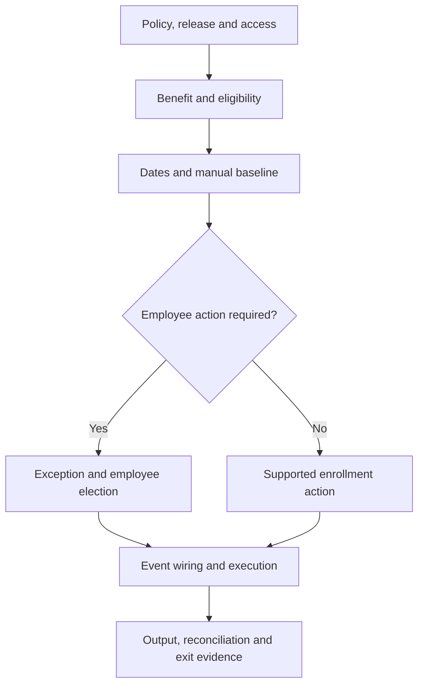

# Global Benefits Configuration Sequence Engine

## 1. The promise and the boundary

**Configure, test and explain one end-to-end, event-driven transport allowance scenario in a prepared SAP SuccessFactors sandbox, producing evidence that another consultant can follow. Finish within 21 hours; experienced consultants may demonstrate the same scoped outcome in 3 hours.**

This is the **Implementation Bootcamp**, powered by **SAP Cloud ALM (CALM) + SAP SuccessFactors Employee Central Global Benefits**, in the Realize phase, and the reusable source for additional bootcamp flavors. It turns topic-based SAP guidance into a dependency-based build sequence. It is a manual playbook and specification for a future sequence engine, not a deployed application or an automated tenant configurator.

The capstone covers one legal entity, one currency, one allowance, employee election outside open enrollment, and an employment-event path. It includes a manual exception baseline before automation, effective-date controls, employee permissions, operational evidence and a payroll handoff check. An optional personal-life-event contrast uses an existing insurance benefit; building an entire insurance product is outside scope.

**A 3-hour demonstration is credible only when prerequisites, relevant tenant access, test data, supported automation and payroll handoff facilities already exist.** Neither route represents a complete multinational implementation, certification of consultant competence, or proof of production readiness. Without a working tenant, submit a design simulation clearly labelled `Designed—not executed`; it does not earn the hands-on completion result.

## 2. Analysis of the proposed qualifying-event explanation

| Statement | Implementation interpretation |
| --- | --- |
| Qualifying events are life/work events | Useful business language. Map the policy event to the actual SAP event objects and processing mechanism in the selected release. A policy label alone does not publish a system event. |
| Every life/work event triggers an exception | Too broad. Decide whether to create, update or end an enrollment, open an employee election exception, or take no action. SAP supports action-based event configuration [S02]. |
| An exception changes eligibility | Do not assume this. An election window and the employee's entitlement are separate controls. Explicitly test eligibility and any approved administrator override. |
| Transfer/grade change always triggers ISC | Too broad. Confirm which system event, subscriber, determination rule and change conditions are supported in the tenant. A saved EC change is not evidence of successful benefits processing [S03]. |
| Marriage/birth affects transport allowance | Only if the employer's documented policy says so. In this capstone they do not. Use those events as a negative test for transport and a contrast for dependent insurance. |
| Allowances are deductions | Ordinary allowance enrollment is compensation-based under pay-component integration. Deductible Allowance is a separate benefit type. Select the correct integration mode and output object [S08]. |
| An exception always sends email | Configuration and delivery must be tested. Exception notices, workflow notices and enrollment-confirmation emails are separate outcomes. Never use inbox receipt as the only evidence of an exception [S09, S10]. |
| Marriage automatically prorates every savings plan | Product-, plan-, country- and release-dependent. Do not transfer savings-plan behavior to transport allowances. No savings-plan proration is claimed or configured here. |
| Adjustment Amount is a universal life-event action | Treat entitlement/amount exceptions separately from enrollment actions. Confirm the applicable benefit type and supported exception values; do not invent a universal dropdown option. |

**Core mental model:** policy event → supported trigger → event determination → benefit event configuration → eligibility and date evaluation → enrollment action or exception → employee/approver action where required → compensation/payroll handoff → reconciliation.

## 3. Architecture Cohort → Township → HR alignment

The **2,640 Learning Journeys belong to the Architecture Cohort**: 11 GICS sectors × 12 architecture streams × 20 Labs. This bootcamp follows the **Application Architect path**, then applies that thinking in the Township project → HR Academy → HR01/AWF1 Workforce Foundations → SAP SuccessFactors Employee Central → Global Benefits → Implementation Bootcamp.

**Process Architect belongs under Business Architect.** Application Architect owns application responsibilities, configuration dependencies, lifecycle behavior and application quality. Business Architect owns process architecture, value streams, capabilities and process improvement. Process inputs inform this implementation without renaming its architecture path.

### Verified GitHub anchors

| Layer | Verified source | Interpretation |
| --- | --- | --- |
| Architecture Cohort | [2,640 Architecture Learning Journeys](https://github.com/nbnayak88/architecture-center-atlas/tree/main/learning-journeys) | Vendor-neutral architecture foundation; not 2,640 SAP courses. |
| Application Architect | [Energy → Application Architecture → Build/IIL](https://github.com/nbnayak88/architecture-center-atlas/blob/main/learning-journeys/01-energy/04-application-architecture/05-build-iil/README.md) | Verified journey **JL-00065**, currently a Planned scaffold. |
| Business Architect | [Business Architect definition](https://github.com/nbnayak88/architecture-center-atlas/blob/main/architecture-streams/02-business.md) | Home of Process Architect specialization. |
| Township project | [Learning Township](https://github.com/nbnayak88/architecture-center-atlas/tree/main/Learning%20Township) | Applied domain/project context. |
| HR Academy | [HR Human Capital Capability Academy](https://github.com/nbnayak88/architecture-center-atlas/tree/main/Learning%20Township/01-HR-Human-Capital-Capability-Academy-Workforce-Monday) | HR domain within Township. |
| HR01/AWF1 | [Autonomous Workforce Foundations](https://github.com/nbnayak88/architecture-center-atlas/tree/main/Learning%20Township/01-HR-Human-Capital-Capability-Academy-Workforce-Monday/HR01-AWF1-Architecting-Autonomous-Workforce-Foundations) | Parent series for EC/Global Benefits. |
| Existing Township bootcamp | [HR01 Energy Foundation Bootcamp](https://github.com/nbnayak88/architecture-center-atlas/blob/main/Learning%20Township/01-HR-Human-Capital-Capability-Academy-Workforce-Monday/HR01-AWF1-Architecting-Autonomous-Workforce-Foundations/01-HR01-ENE-energy/02-Foundation/bootcamp/README.md) | Existing pathway **PATH-HR01-ENE-Foundation-Bootcamp**; supports the product-specific flavor below. |
| Current application/flavor source | [This existing configuration sequence](https://github.com/nbnayak88/successlabs-hr-autonomous-workforce/blob/main/learning/global-benefits/configuration-sequence-engine/README.md) | SAP SuccessFactors EC Global Benefits Implementation Bootcamp, powered by SAP Cloud ALM. |

The repository physically keeps `learning-journeys/` and `Learning Township/` as separate directories. The arrows describe the learner's progression and cross-reference model, not a claim that folders are physically nested. Preserve both catalogues and their IDs. The Township foundation tier is a verified application anchor, not a claim that every bootcamp must be Foundation-level.

The attached workbook has 2,640 unique IDs using older sector/stream/track codes. Keep **ENE-APP-IMP** only as the workbook cross-reference; do not substitute it for verified GitHub journey **JL-00065**. Workbook `Track=Implementation` maps to the relevant Build/IIL flavor. No workbook content/status is changed. All twelve architecture streams remain available across the cohort; this particular course has one primary path, Application Architect, with cross-disciplinary reviews where useful.

The Architecture Cohort, Township domain series, curriculum tier, lab theme, course/module and delivery route are **separate dimensions**. They should not be conflated into another multiplication of required courses. The GitHub architecture README supplies the approved 22 Pahacha mastery paths; attach relevant path IDs to activities rather than inventing replacement themes.

## 4. Timebox and adaptive routes

### Guided Track — Train Model: up to 21 hours across three calendar weeks

The following three-day intensive option remains available within the three-week calendar limit. Each intensive day has seven configuration cards × 45 minutes = 315 minutes. Add 30 minutes of shared review, 45 minutes of paired integration/retest, and 30 minutes of breaks = **420 minutes**. Three days = **1,260 minutes / 21 hours**, including breaks. Preparation checks are inside the timebox; access provisioning that cannot be completed there is a blocker, not hidden homework.

| Day | Cards | Shared review: 30 min | Integration/retest: 45 min | Breaks | Total |
| --- | --- | --- | --- | --- | --- |
| 1: Establish and build | C01–C07: 315 min | Policy and dependency review | Recheck baseline benefit and eligibility | 30 min | 420 min |
| 2: Connect events | C08–C14: 315 min | Date and event reasoning | Trace one event across objects and logs | 30 min | 420 min |
| 3: Prove and hand over | C15–C21: 315 min | Explain results and defects | Close high-impact failures and repeat critical flow | 30 min | 420 min |

Inside a 45-minute card: 5 minutes retrieve/predict, 5 inspect the relevant SAP reference, 20 configure, 10 test, 5 record evidence. A card can be verified early; use saved time for a failing scenario. At the cap, record incomplete work and the exact blocker. Do not silently extend the bootcamp.

### Fast Track — Flight Mode!: three hours total

**Same destination, same outcome, same evidence standard. Only the pace and coaching support differ.** Flight Mode! is the three-hour fast track; Train Model provides guided progress up to 21 hours. This is a challenge route, not accelerated reading of every page. Reuse and verify existing objects; do not rebuild a functioning tenant merely to generate activity.

| Minutes | Task | Required proof |
| --- | --- | --- |
| 0–15 | C01–C03: entry check and policy decision | Release, permissions, policy and dependency baseline |
| 15–45 | C04–C07: inspect/build allowance and eligibility | Positive and negative employee results |
| 45–75 | C08–C10: dates, manual exception and event definition | Working out-of-window employee election |
| 75–115 | C11–C14: wire and test the supported event route | Trigger-to-result log trace; no duplicate processing |
| 115–140 | C15–C17: approval, communication and payroll handoff | Observed lifecycle state and reconciled output |
| 140–170 | C18–C20: run the acceptance pack and handover | All mandatory assertions evidenced or marked blocked |
| 170–180 | C21: independent explanation and exit decision | Five-minute demo plus concise decision record |

If event wiring, debugging or prerequisites exceed the expert budget, switch to the remaining guided time allowance. **Total learning time across both routes must remain ≤21 hours.** Passing is based on evidence, not speed. Three-hour completion is possible, not promised.

## 5. Entry gate and release contract

- Use a sandbox/test tenant and synthetic employees. Identify tenant, environment, actual release and enabled Benefits UI before configuration.
- Record the exact SAP documentation version selected in Help Portal. Research on 21 October 2026 surfaced both 1H 2026 and 2H 2026 pages. A page labelled LATEST or a published release note does not prove the feature is active in this tenant.
- Verify EC core, required Benefits/MDF capabilities, Benefits Admin Overview, Configure Business Rules, object access, ISC access where used, and employee Benefits UI. Record actual enabled settings; route privileged enablement to the authorized owner rather than inventing an Admin Center switch [S11].
- Check legal entity, location, grade, currency, event reasons and employee job records. Ensure prerequisite records exist as of each test's effective date.
- Confirm configuration-admin, employee, approver and integration-test roles. Verify target populations, not just permission labels.
- Confirm a test outbound-mail route, optional workflow approver and one payroll handoff validation method. Do not substitute a spreadsheet for an observed integration result without labelling it a simulation.
- Inspect existing automatic-enrollment jobs and ISC flows to avoid overlapping processing. Capture a baseline before editing shared objects.
- Freeze one supported event-automation route for the capstone. A feature unavailable in the selected release becomes a recorded gap; do not fabricate success through manual record creation.

**Gate:** begin tenant execution only when the minimum sandbox path is available. If blocked, spend the allocated time on the policy/design artifacts, label the result as a design simulation, and leave execution status unverified.

## 6. Illustrative policy and test data

All company attributes, IDs, values and dates below are **training assumptions**, not confirmed OmniVerse facts, SAP defaults or statutory rules. This example uses an Energy enterprise context but deliberately limits scope to one India legal entity.

| Policy field | Training value |
| --- | --- |
| Legal entity | `SL_IN01` — fictional India entity |
| Benefit | `SL_GB_TRANSPORT_IN` — Transport Allowance |
| Currency/frequency | INR, monthly |
| Eligible employee | Active employee in SL_IN01, location SL_SITE_A, grade G5 or G6 |
| Entitlement | G5: ₹3,000/month; G6: ₹5,000/month; other populations ineligible |
| Employee election | Required for the baseline path; approval only if configured in the agreed scenario |
| Annual election window | 1–15 January 2026; enrollment period 1 January–31 December 2026 |
| Qualifying work event | Hire or transfer into the eligible population after the annual election window |
| Exception start/end | Event date E through E+29 calendar days, both dates included: 30 days |
| Enrollment effective date | Event date E, subject to successful election and applicable approval processing |
| Payment-effective policy | First day of the month after E, deliberately distinct from enrollment effective date |
| Loss of eligibility | End entitlement per approved effective-date policy; do not assume granting an exception ends payment |
| Marriage/birth | No transport entitlement change in this case |
| Payroll mode | Pay Components for this exercise; confirm tenant support and mappings before use |
| Proration | Not implemented by this lab; payroll owner must define production treatment |

**Date oracle:** E = 10 June 2026; exception window = 10 June–9 July 2026; enrollment effective = 10 June; intended allowance payment-effective = 1 July. In a test tenant use an appropriate controllable test date or shift the whole scenario to a currently executable date and recompute expected values. Do not expect an expired June window to be usable in October. Test future and retrospective cases separately.

Synthetic personas:

| Employee | Baseline and change | Expected policy result |
| --- | --- | --- |
| SL_E01 | Active G5, moves from SL_OFFICE to SL_SITE_A | Newly eligible, ₹3,000, election opportunity |
| SL_E02 | Active G6, new hire at SL_SITE_A | Eligible, ₹5,000, supported new-hire route |
| SL_E03 | Active G4 at SL_SITE_A | Ineligible; no allowance output |
| SL_E04 | Active G5 moves away from SL_SITE_A | Loss-of-eligibility handling; no continuing unauthorized payment |
| SL_E05 | Eligible G5 reports marriage without a job change | No transport change; optional insurance contrast |
| SL_E06 | Employee in another legal entity | No benefit access through this configuration |

Create separate cloned employees or reset to a documented baseline for tests that otherwise interfere with one another.

## 7. Sequence logic and evidence model



Build order differs from runtime order: create an event definition before referencing it in rules/configuration; create business rules before attaching them; validate configuration before activating the subscriber. At runtime, the system trigger must reach determination and action processing. No card passes merely because its Save button worked.

| Card IDs | Dependency rule |
| --- | --- |
| C01–C03 | Complete policy, access and data baseline before building. |
| C04–C07 | Build prerequisite benefit objects, dates and eligibility; verify the ordinary path. |
| C08–C09 | Establish date rules and a manual exception baseline. |
| C10 | Create work/life event definition before event references. |
| C11–C12 | Create determination rule/record and event configuration using the existing event and rules. |
| C13–C14 | Activate the supported subscriber only after the configuration chain is valid. |
| C15–C17 | Verify employee action, communication and financial output. |
| C18–C21 | Execute acceptance, diagnose, rehearse movement and demonstrate handover. |

Every card records: ID; purpose; predecessor IDs; actual screen/object; input policy; configuration changes; expected result; observed result; evidence reference; source IDs; failure diagnosis; rollback note; owner; actual minutes. Use states `Not started`, `Ready`, `In progress`, `Blocked`, `Configured`, `Verified`. A gate opens only when required predecessor evidence is verified. `Configured` and `Verified` are different states.

## 8. The 21 configuration cards

### C01 — Confirm the policy and event-to-action decision

**Depends on:** none. **Surface:** policy/design worksheet. **Output:** approved training decision table.

1. Separate business event, employee eligibility, entitled amount, election window, enrollment effective date and payment-effective date.
2. Decide for each event whether the employer mandates enrollment or permits an employee election. Use the election path for the baseline allowance; reserve mandatory auto-enrollment as a labelled variant.
3. Specify transfer-in, transfer-out, new-hire, grade-change and personal-event outcomes. A grade change without a supported event path needs explicit redesign or a supported job; do not assume a subscriber exists.
4. Identify business approver, payroll owner and consultant. Record unresolved production policy separately from fixed training assumptions.
5. **Verify:** explain why a marriage does not change this transport allowance. **Evidence:** policy table and event-action decisions. **Recovery:** correct the policy before editing rules.

### C02 — Verify enablement, release and role-based permissions

**Depends on:** C01. **Surfaces:** Admin Center search, permission roles, enabled Benefits UI; authorized provisioning owner if needed.

1. Log in as configuration admin; confirm the tools required by this sequence are available. Capture tenant release and actual object labels.
2. Check Benefits/MDF enablement with the authorized owner if missing. Use the current guide; do not run historical Best Practices upgrades blindly [S11].
3. Grant scoped object and admin-tool access to the training role. Confirm employee access to their own benefit information, dependent data only where relevant, and required workflow access.
4. Proxy/test as SL_E01 and SL_E06; verify that seeing an admin tool is not equivalent to receiving employee eligibility.
5. **Verify:** admin can maintain training configuration; employees cannot administer other employees. **Evidence:** permission matrix and positive/negative access results. **Recovery:** revert the training-role delta, not a shared role wholesale.

### C03 — Baseline foundation records and synthetic employees

**Depends on:** C02. **Surfaces:** existing EC employee and foundation-data maintenance tools.

1. Verify SL_IN01, SL_SITE_A, relevant grades and INR exist on the test dates. Use actual sandbox IDs if the illustrative IDs cannot be created.
2. Create or identify six synthetic employees; record employment status, entity, grade, location, hire date and effective-dated job history.
3. Prepare before/after snapshots for SL_E01's transfer. Check missing grade/location and unauthorized-entity cases.
4. Inventory existing benefit jobs, events, schedules, workflows and pay components. Record any collision with the planned benefit code.
5. **Verify:** a rule can resolve the expected job data as of E. **Evidence:** masked baseline matrix. **Recovery:** restore synthetic records using the tenant's supported correction process; preserve event history needed for diagnosis.

### C04 — Prepare benefit structure and calendar prerequisites

**Depends on:** C03. **Surface:** Benefits Admin Overview; use Manage Data only for objects maintained there in the selected release.

1. Inventory the existing benefit program and schedule objects needed by the Allowance configuration. Reuse valid shared prerequisites rather than duplicate them.
2. If required, create a training Benefit Program and a Benefit Enrollment Schedule using the exact supported object forms. Record their external codes.
3. Distinguish the benefit's existence/effective date, the employee election window, and the active enrollment period. Store the annual window and period from Section 6.
4. Resolve any circular references using the supported create/attach order shown by the target UI. Do not activate the benefit until all mandatory references are resolved.
5. **Verify:** referenced records are effective when the benefit is used. **Evidence:** object list with dates. **Recovery:** remove only unused training objects in reverse dependency order.

### C05 — Configure the allowance master record

**Depends on:** C04. **Surface:** Benefits Admin Overview → create/maintain Benefit, selecting the supported Allowance type.

1. Create `SL_GB_TRANSPORT_IN`, with employee-facing name, start date, INR and relevant program/legal-entity assignment in the fields available in this release.
2. Maintain the enrollment and payment details supported by this allowance configuration. Set the intended employee-election behavior; do not select Deductible Allowance for an ordinary employer-paid transport allowance.
3. Record actual fields for schedule, frequency, employee edit/opt-out controls, contact and description. Treat “enrollment required” and “automatic enrollment” as distinct configuration decisions.
4. Attach the eligibility/amount rule after C06 and pay component after C07. Keep the record inactive or otherwise controlled until mandatory configuration is complete.
5. **Verify:** correct type and currency; no unexplained defaults. **Evidence:** configuration snapshot and field register. **Recovery:** deactivate the training benefit before changing dependent event processing.

### C06 — Implement eligibility and entitlement rules

**Depends on:** C05. **Surface:** Configure Business Rules and the allowance's supported rule field [S04].

1. From the allowance rule field or current rule-scenario catalogue, select the supported Benefits scenario and base/result objects. Record their actual names. The policy pseudocode below is not importable SAP syntax.
2. Implement: active + SL_IN01 + SL_SITE_A + G5 → eligible/₹3,000; same with G6 → eligible/₹5,000; all other cases → the scenario's supported ineligible result.
3. Handle null grade, null location and wrong entity explicitly. Evaluate the approved effective-dated employee context; do not substitute today's record for E without checking the scenario.
4. Attach the rule to the benefit's applicable eligibility/entitlement field. Confirm how the chosen rule scenario returns eligibility and amount; avoid conflicting independent amount defaults.
5. Test G5, G6, G4 and another entity before connecting any event. Record returned values, not just rule names.
6. **Verify:** expected four results and null-data handling. **Evidence:** decision table plus rule results. **Recovery:** restore the last verified rule version and rerun the same input set.

### C07 — Configure the allowance's compensation/payment handoff

**Depends on:** C06. **Surfaces:** benefit payroll-integration settings and relevant pay-component maintenance [S08].

1. Confirm the actual tenant integration mode. This example uses Pay Components; Benefit Objects mode requires a different downstream trace.
2. Create/reuse a dedicated training pay component according to the supported benefit mapping; record actual code, frequency and currency. Under pay-component integration, do not reuse this benefit's component in another benefit.
3. Map the ordinary allowance to compensation output. Deduction-based examples from insurance or Deductible Allowance are not templates for transport earnings.
4. Complete a controlled ordinary enrollment baseline where the schedule permits, or record why a currently closed window correctly prevents it. Do not alter a shared annual schedule merely to force a successful screen.
5. **Verify:** configuration references resolve; any resulting compensation record has expected component/amount. **Evidence:** before/after records. **Recovery:** reverse synthetic enrollment/output through supported processing, then verify no orphan compensation record remains.

### C08 — Build date rules and boundary expectations

**Depends on:** C07. **Surface:** Configure Business Rules, Benefits Management scenarios [S02, S05].

1. Prepare the exception enrollment-window rule using the supported scenario `Configure Benefits Enrollment Window Rule using Exception` where applicable.
2. Prepare event-based enrollment effective-date rule using `Configure Benefit Enrollment Effective From Rule via Benefit Life Event Configuration` where present.
3. Where the selected action exposes it, prepare the scenario `Configure Benefit Deduction Change Effective From Rule via Benefit Life Event Configuration`. Its field name does not by itself prove how an ordinary allowance's compensation date is set; verify the allowance output and supported payment-date fields separately.
4. Implement the training date oracle through the available scenario inputs/outputs. Record whether the window end is inclusive; prove E+29, E+30, month-end and leap-day behavior with examples.
5. Distinguish event date, publication timestamp, employee submission date and approval date. Explain which one each rule consumes.
6. **Verify:** expected dates on an observed exception/enrollment/output record. **Evidence:** date decision table and actual rule attachments. **Recovery:** detach erroneous training rules and restore baseline; do not repair dates by editing unrelated payroll records.

### C09 — Prove a manual out-of-window enrollment exception

**Depends on:** C08. **Surface:** Admin Center → Benefits Admin Overview → Create New → Benefits Exception [S06].

1. Select SL_E01, confirm legal entity, choose `Enrollment` under `Exception For` and request a new exception window where supported.
2. Enter exception start/end and Benefit Event Date using a currently executable test date. Scope to the intended benefit/period; verify the selected benefits before saving.
3. Select a valid work/life configuration if required for date control. If it has not yet been created, return after C12 and finish that rule-driven variant; explicitly capture any manual-date baseline separately.
4. Proxy as the employee outside the normal open window; verify the exception grants the intended election opportunity. Submit an enrollment and inspect effective date and lifecycle state.
5. Repeat with ineligible SL_E03: an exception must not silently create an unauthorized entitlement. Record the actual override behavior if admin permissions permit one, and restrict that override accordingly.
6. **Verify:** stored exception, usable window and correct employee election. **Evidence:** record IDs and results. **Recovery:** close/remove the test exception with supported actions, then reset employee enrollment before automation testing.

### C10 — Create the benefit work/life event definition

**Depends on:** C09 manual baseline or a documented pending configuration dependency. **Surface:** Benefits Admin Overview → Create New → Benefit Work/Life Event [S01].

1. Create a distinct transport-transfer event, for example `SL_GB_EVT_SITE_TRANSFER`, using Event Code, Effective Start Date and Benefit Event Name.
2. If testing a new-hire path, create a separate event code with its own approved purpose. Avoid sharing one event across incompatible policy actions.
3. Record which supported system trigger will resolve each benefit event. Creating this object alone neither listens for a transfer nor opens an exception.
4. **Verify:** event definition can be selected by downstream rules/configuration as of the correct date. **Evidence:** event ID and effective date. **Recovery:** disable references before removing a training event.

### C11 — Configure event determination

**Depends on:** C10. **Surfaces:** Configure Business Rules → Benefits Management; Benefits Admin Overview → Benefit Event Determination [S03, S07].

1. Use the current supported `Determine Benefit Work Event` scenario for the system-event route. Build conditions that match the intended population/change rather than an unqualified Always True for all employees.
2. Return the required work/life event using the supported `Add To` mechanism; record a diagnostic comment if available.
3. Create the Benefit Event Determination record for the chosen system event and scope legal entities appropriately.
4. Validate transfer-specific setup in the target release. Do not assume every system-event dropdown contains Job Transfer or reuse a rehire determination record unchanged.
5. If transfer automation is unsupported or unavailable, select a verified new-hire route as the bootcamp automation path; retain transfer as an explicitly manual scenario/gap. This is a scope adaptation, not proof of transfer automation.
6. **Verify:** selected system event resolves the intended benefit event only. **Evidence:** determination record, conditions and log result. **Recovery:** deactivate/detach the training determination before activating a replacement.

### C12 — Configure the event's benefit actions or election exception

**Depends on:** C08, C10, C11. **Surface:** Benefits Admin Overview → Benefit Work/Life Event Configuration; some event guides use Benefit Life Event Configuration [S02].

1. Create the event configuration ID/name, effective start, event reference, legal entity and appropriate ongoing/upcoming benefit period.
2. Add the transport benefit; choose the intended enrollment action only if policy mandates system action.
3. For the employee-election path, use the supported `Setup Eligible Enrollment Action for Employee` section rather than assuming `Create Enrollment` is an exception action.
4. Attach the relevant window/effective-date rules; inspect benefit-level details after saving. Record which fields exist for this event and benefit type.
5. Keep the auto-enrollment variant separate from the exception variant; prove they cannot both process the same employee/event into duplicate results.
6. **Verify:** one event-action configuration produces the planned outcome and dates. Complete C09's rule-driven manual test if previously pending. **Evidence:** configuration ID and rule links. **Recovery:** deactivate this training configuration and revert references before reprocessing an event.

### C13 — Connect the supported Intelligent Services route

**Depends on:** C12. **Surface:** Admin Center → Intelligent Services Center (ISC) [S03, S11].

1. Open the supported system event, inspect its available Benefits subscriber, and compare against release-specific SAP instructions.
2. Configure the documented subscriber/timing and save the flow. Record exact event and subscriber names from the tenant; historical guides have different labels.
3. Inspect existing flows and jobs for duplicate ownership of the same event. Do not leave legacy and replacement routes simultaneously active without deliberate design.
4. Publish a controlled supported EC change on a fresh synthetic employee. Capture event timestamp, effective date, employee key and subscriber result.
5. **Verify:** source event reaches Benefits processing; a saved flow alone does not pass. **Evidence:** ISC result plus Benefits Events Log. **Recovery:** restore prior flow configuration and deactivate only the training route, preserving diagnosis records.

### C14 — Trace automated processing end to end

**Depends on:** C13. **Surface:** Benefits Events Log, exception/enrollment objects and employee UI [S03, S12].

1. For the chosen supported automation path, trigger one synthetic hire/transfer and trace event → determination → configuration → expected exception or enrollment.
2. Reconcile employee key, event date, benefit, legal entity and configuration ID across the records. Verify rule-derived dates and amount.
3. Test one negative population. It must not obtain an unintended allowance simply because the ISC event was published.
4. Exercise a safe controlled repeat/reprocessing scenario supported by the tenant. Check existing results and document actual duplicate handling; do not claim universal exactly-once delivery.
5. **Verify:** one intended outcome, expected date/amount and traceable logs. **Evidence:** a linked record chain. **Recovery:** fix the failed layer, reset affected synthetic records and reprocess only by a supported mechanism.

### C15 — Verify employee editing, opt-out and approval behavior

**Depends on:** C14. **Surfaces:** employee Benefits UI, workflow inbox, Benefits Exception [S13].

1. Inspect benefit edit and opt-out settings before choosing an exception type. If an edit exception is tested, the employee must have an existing enrollment.
2. Use `Edit of Enrollment` or `Edit and Opt Out of Enrollment` only where supported for that benefit and policy. Compare allowed actions inside/outside the window.
3. If enrollment approval is required, submit, approve and reject separate tests. Check when the effective financial output appears; a pending request is not an active benefit.
4. Distinguish enrollment workflow from employee-reported life-event approval. The latter can involve Benefit Employee Life Event Details object workflow configuration [S14]; it is a conditional extension, not a mandatory step for ISC work events.
5. **Verify:** permitted employee actions and approval states match policy. **Evidence:** transaction IDs/state changes. **Recovery:** cancel/reject/reset test transactions through supported workflow processing.

### C16 — Configure and test communications

**Depends on:** C15. **Surfaces:** applicable exception/document-generation configuration, Email Notification Templates Settings, employee contact data [S09, S10].

1. List three separate notices: exception/election opportunity, workflow decision and enrollment confirmation. Identify the actual supported mechanism for each.
2. Configure the relevant templates and prerequisites in the selected release; use only delivered placeholder names.
3. Include employee-facing action, benefit, start/end dates, help contact and a meaningful link where supported. Avoid sensitive family information in email.
4. Confirm valid business email, sender/contact and enabled notification controls. Inspect delivery evidence separately from stored transaction success.
5. **Verify:** an intended test message reaches the approved test destination with resolved fields and correct dates. **Evidence:** sanitized message and processing record. **Recovery:** suppress the training notification route and correct templates without deleting valid benefit results.

### C17 — Reconcile allowance output to the payroll handoff

**Depends on:** C16. **Surfaces:** compensation records, integration output and available payroll test facility [S08].

1. Trace an approved allowance enrollment to the expected compensation record using the tenant's pay-component mode. Record amount, INR, frequency, start/end and benefit/pay-component identifiers.
2. Compare the payment-effective result with the policy oracle. Do not assume an event's deduction-date rule automatically controls allowance earnings.
3. Validate supported outbound payload/replication acceptance. If no payroll test system is available, label the result `EC output verified; payroll execution unverified`.
4. Where payroll testing is available, reconcile the actual payroll result, period, proration and variance with the payroll owner. Never present a sample calculation as executed payroll.
5. **Verify:** no unexpected duplicate earnings, no unexplained amount/date variance at the observed boundary. **Evidence:** reconciliation rows with source record references. **Recovery:** coordinate benefit/output correction and verify downstream reversals through the supported payroll process.

### C18 — Execute the acceptance and boundary pack

**Depends on:** C17. **Surface:** Section 9 test matrix and tenant tools.

1. Run all mandatory tests, using isolated employees or documented resets. Record actual values alongside expected values.
2. Include wrong entity, missing data, expired window, first/last allowed day, duplicate processing and approval behavior where enabled.
3. Test an unrelated marriage event as a no-change transport scenario. A personal-event workflow is optional; inventing a dependent-based transport entitlement is not.
4. Validate loss of eligibility using a supported processing path. Prove compensation does not continue beyond the approved end policy; if the automated path is unavailable, record the manual control and automation gap.
5. **Verify:** every mandatory assertion passes; blocked tests remain visibly blocked. **Evidence:** test register. **Recovery:** reopen the responsible card, not the whole build.

### C19 — Diagnose, repair and rerun one real defect

**Depends on:** C18. **Surface:** relevant logs and configuration.

1. Use a naturally occurring defect or deliberately detach a training rule in an isolated scenario. Record the baseline and reversible change.
2. Locate the failing layer: data → eligibility → dates/schedule → event determination → subscriber → result → output.
3. State expected versus actual, propose one cause, change one variable and rerun the same input. Preserve failed evidence.
4. Verify adjacent negative cases after repair; restoring the happy path must not broaden eligibility.
5. **Verify:** root cause and before/after proof. **Evidence:** defect record and retest. **Recovery:** restore the pre-experiment configuration if the hypothesis fails.

### C20 — Prepare configuration movement and support handover

**Depends on:** C19. **Surface:** approved configuration transport/export tools and handover register.

1. Inventory objects by code, effective date, dependencies and owning environment. Include rules, programs/schedules, benefit, pay component, event definition, determination, event configuration, workflows and notifications actually changed.
2. Classify which objects use supported transport tooling versus controlled export/import or manual target setup. Do not assume every Benefits object is transported the same way.
3. Define import order from prerequisites to rules to benefit references to event configuration; activate target subscribers only after configuration checks.
4. Rehearse in another sandbox if available. Otherwise mark movement `Designed—not rehearsed`. Document target IDs/environment settings and smoke tests.
5. Create rollback instructions that account for already-created employee and compensation transactions; reverting configuration alone does not reverse financial outputs.
6. **Verify:** a second consultant can follow the pack and locate failures. **Evidence:** movement checklist, support ownership and rehearsal status. This is Realize handover preparation; actual production deployment belongs to the project's authorized Deploy process.

### C21 — Demonstrate, reflect and decide the exit

**Depends on:** C20. **Surface:** live sandbox demonstration and evidence register.

1. Explain the policy, select a fresh test employee and predict the result before executing.
2. Show one positive and one negative case, the exception/election path, one supported automated path, and the actual compensation handoff.
3. Explain a date boundary and the defect repaired in C19. Distinguish verified facts, policy assumptions and unresolved gaps.
4. Hand over the configuration register, tests, defect evidence and support notes. Record actual total minutes.
5. **Verify:** independent evidence review against Section 11. **Evidence:** signed review or reviewer notes. **Recovery:** issue a bounded remediation plan within remaining time; do not convert an incomplete build into a completion claim.

## 9. Mandatory acceptance pack

Test dates must be executable in the sandbox. Values below refer to the shifted equivalent of the Section 6 policy if dates are moved. “No new result” means no unauthorized exception/enrollment/compensation outcome, not necessarily absence of a diagnostic log.

| ID | Scenario | Expected assertion | Evidence boundary |
| --- | --- | --- | --- |
| T01 | G5 employee enters eligible site | Eligibility ₹3,000; intended exception/election path | Rule and exception/enrollment |
| T02 | G6 new hire at eligible site | Eligibility ₹5,000; supported event route result | Event log and result |
| T03 | G4 at site | Ineligible; no unauthorized payment | Rule/UI/output |
| T04 | Wrong legal entity | No benefit access/result under SL_IN01 configuration | RBP, eligibility and event scoping |
| T05 | Missing grade/location | Supported ineligible/error handling; no accidental amount | Rule result and log |
| T06 | Outside annual open window, no exception | Election blocked by intended schedule | Employee UI |
| T07 | Same employee with valid exception | Intended enrollment available and submitted | Exception and enrollment |
| T08 | First day E | Election allowed within policy window | UI and stored dates |
| T09 | Last day E+29 | Election allowed through final included date | UI/controlled boundary proof |
| T10 | Day E+30 | Election window closed; no unauthorized edit | UI/controlled boundary proof |
| T11 | Enrollment versus payment dates | E and next-month start remain distinct as designed | Enrollment and compensation output |
| T12 | Repeat supported event processing | No unintended duplicate benefit/payment; observed repeat behavior documented | Logs and record counts |
| T13 | Transfer out/loss of eligibility | Entitlement/output ends according to the explicitly chosen policy | Result and compensation end state |
| T14 | Marriage without relevant job change | No transport amount or entitlement change | Before/after transport result |
| T15 | Employee/admin separation | Employee cannot administer another worker | RBP negative test |
| T16 | Communication | Correct resolved notice, window and action in test destination | Message and transaction |
| T17 | Payroll handoff | Correct component, amount, currency, frequency and dates at verified boundary | Output/payload acceptance |
| T18 | Defect and repair | Same test fails then passes after explained correction; negatives still pass | Defect and retest |

Conditional tests: T19 approve/reject enrollment if approval is enabled; T20 edit/opt-out if in scope; T21 actual payroll result if a payroll test system is available; T22 prospective/retrospective correction if supported in the scoped automation. State `Not applicable` only with a documented scope reason. Mark unavailable mandatory tests `Blocked`, never passed. A rule simulation proves a date calculation; it does not by itself prove that the employee UI enforces that boundary.

## 10. Troubleshooting in dependency order

| Symptom | Inspect first | Narrow corrective action |
| --- | --- | --- |
| Admin tool/object missing | Release, enablement, RBP and target population | Resolve access/feature ownership before rebuilding objects. |
| Employee sees no benefit | Entity, rule result, benefit effective dates/status and schedule | Test rule input dates; check UI visibility controls. |
| Exception exists but election blocked | Exception scope/dates, enrollment settings, eligibility and approvals | Fix the specific mismatch; do not open all annual schedules. |
| Manual baseline works, automation fails | ISC event publication, subscriber, determination and event-config chain | Locate the first missing/failed record. |
| Unexpected employees receive allowance | Determination scope versus benefit eligibility | Repair overly broad condition and retest negative population. |
| Correct eligibility, wrong amount | Rule output, grade effective date and conflicting defaults | Compare expected grade/amount at E with actual results. |
| Enrollment correct, payment date wrong | Actual compensation output mapping and supported allowance date controls | Separate allowance payment controls from deduction-rule assumptions. |
| Duplicate output | Overlapping jobs/flows, repeat processing and prior enrollment | Remove overlap, use supported corrections, reconcile outputs. |
| No email | Appropriate notification mechanism, enabled settings, recipient/sender and template | Correct message route without reopening valid transactions. |
| Transfer-out still paid | Loss-of-eligibility action, end dates and downstream correction | Trace end-to-end termination of entitlement and earnings. |

## 11. Tangible outcome and completion standard

By completion, the learner can translate a benefit policy into configuration dependencies; configure the scoped allowance; explain window/effective/payment dates; prove one manual election exception and one supported event-automation path; diagnose a failure; and hand over evidence another consultant can reproduce.

Required submission:

1. One policy/event-to-action decision table, with assumptions labelled.
2. One configuration register covering every changed object, rule and effective date.
3. One trace from employee event to benefit result to observed financial output.
4. All 18 mandatory tests with actual results and evidence; conditional tests explicitly classified.
5. One defect with root cause and verified repair.
6. One reconciliation register distinguishing EC output, integration acceptance and payroll execution.
7. One support/movement pack and five-minute independent explanation.

**Hands-on completion:** all mandatory assertions pass, no unresolved critical entitlement/security/duplicate-payment defect, evidence is independently reviewable, and elapsed learning time ≤1,260 minutes. Do not hide a blocked mandatory assertion behind an average quiz score.

Use result labels precisely: `Hands-on scope completed`, `Partially verified—blocked items listed`, or `Design simulation only`. Production readiness remains a separate project decision requiring its own localization, volume, integration, security, regression, migration and deployment evidence.

Value measures to explore after implementation, with a measured baseline rather than invented benefits: exception processing time, eligible employees successfully enrolling within window, date/amount error rate, manual interventions, duplicate outputs, and payroll handoff rejection rate.

## 12. Working registers learners can copy

### Configuration register

| Card | Object/type | Actual code | Effective date | Predecessors | Changed fields/rules | Expected | Actual | Evidence | State | Minutes |
| --- | --- | --- | --- | --- | --- | --- | --- | --- | --- | --- |
| C__ | To complete | To complete | To complete | To complete | To complete | To complete | Not executed | To complete | Not started | 0 |

### Event execution trace

| Test/worker | Source event/effective date | Publication reference | Determination/event config | Exception/enrollment ID | Compensation/output ID | Expected/actual | Result |
| --- | --- | --- | --- | --- | --- | --- | --- |
| To complete | To complete | To complete | To complete | To complete | To complete | To complete | Not executed |

### Reconciliation register

| Worker | Benefit/component | Amount/currency/frequency | Enrollment date | Expected payment start/end | Actual output dates | Interface acceptance | Actual payroll result | Variance/resolution |
| --- | --- | --- | --- | --- | --- | --- | --- | --- |
| To complete | To complete | To complete | To complete | To complete | To complete | Unverified | Unverified | To complete |

### Defect/decision record

| ID | Test/card | Expected vs actual | Hypothesis/root cause | Change and rollback | Retest evidence | Owner | Status |
| --- | --- | --- | --- | --- | --- | --- | --- |
| To complete | To complete | To complete | To complete | To complete | To complete | To complete | Open |

Use synthetic IDs in shareable portfolios. Store actual tenant identifiers and sensitive employee information only in the customer's approved evidence system.

## 13. Facilitation that builds independent judgment

- Start each card by asking “What should happen, and which object owns that decision?” before opening the screen.
- Work in pairs as consultant and reviewer; exchange roles after a dependency group. The reviewer asks for evidence, not memorized navigation.
- Use short retrieval prompts on days 2 and 3: explain eligibility versus exception; reconstruct the dependency chain; predict the date oracle without notes.
- Make one safe controlled experiment: change only the grade, date or event scope; predict, run, compare and restore. Keep the experiment within existing card time.
- Give progress visibility through verified artifacts. A learner blocked by access is not necessarily weak in the domain; separate environmental blockers from reasoning gaps.
- End with a teach-back and a portable artifact that helps the next learner. This turns a cohort into a shared learning practice rather than a collection of recordings.

## 14. Reusable source template for future bootcamps

Copy this structure and replace the product-specific sequence; do not mechanically copy SAP objects into another domain. The universal pattern is **Decide → Prepare → Build → Connect → Prove → Explain**. It groups activities without replacing BAISI PAHACHA™ or the academy's catalogue.

```yaml
bootcamp:
  id: SL_PRODUCT_CAPABILITY_001
  version: 1.2.0
  title: "A concrete implementation outcome"
  source_status: "draft / ready-for-tenant-validation / tenant-verified"
  product_release: "Record actual target version"
  journey_id: "Copy an existing LJ-ID from the catalogue"
  sector_code: "Existing catalogue code"
  architecture_stream_code: "Existing catalogue code"
  track_code: IMP
  delivery_lab: "IIL / Build"
  activate_phase: Realize
  fast_track: "Flight Mode!"
  guided_track: "Train Model"
  same_outcome_and_rubric: true
  minimum_expert_minutes: 180
  maximum_total_minutes: 1260
  guided_days: 3
  daily_minutes: 420
  cards_per_day: 7
  card_minutes: 45
  daily_shared_review_minutes: 30
  daily_integration_retest_minutes: 45
  daily_break_minutes: 30
  entry_gate: "Tenant, access, data, policy and integration boundaries"
  outcome: "One specific end-to-end behavior with visible evidence"
  out_of_scope: ["Explicit exclusions"]
  completion: "All mandatory assertions passed; no critical open defect"
  evidence_status: "Designed / configured / executed / verified"
  canonical_source: "GitHub file URL"
  knowledge_hub: "Notion page URL"
  source_register: "Official versioned references with claim mapping"
```

### Repeatable configuration-card template

```markdown
### Cxx — Action and object

Purpose: The learner block this card removes.
Depends on: Verified predecessor IDs.
Policy input: Decision or approved assumption.
Actual release/surface/object: Confirmed tenant label.
Configuration inputs: Field, value, meaning and dependency.
Actions: Short numbered build sequence.
Rule contract: Scenario, inputs, output, attachment point and test oracle.
Expected result: Observable behavior, including dates and amount if relevant.
Validation: Positive, negative and boundary assertions.
Evidence: Record/log/test IDs and approved screenshot reference.
Failure diagnosis: First dependency to inspect.
Recovery: Supported reversible action and downstream effects to verify.
Owner/state/minutes: Recorded actuals; never infer verification from Save.
Sources: Official reference IDs; distinguish policy from product behavior.
```

### Authoring checklist for every future bootcamp

1. Define a narrow, measurable promise before selecting topics.
2. State entry conditions and the expert-route assumptions explicitly.
3. Draw the object dependency chain, then assign stable card IDs.
4. Allocate no more than 1,260 total minutes, including preparation, testing, documentation and breaks. Make optional extensions replace allocated work or remain outside the completion claim; never hide extra mandatory homework.
5. Provide one illustrative case, synthetic data and an expected-results oracle.
6. Separate policy decisions, verified product behavior and unverified tenant-specific details.
7. Include a manual baseline where it helps isolate automation, then prove the supported automated path.
8. Require negative, date-boundary, security and duplicate/output tests where applicable.
9. Include troubleshooting, rollback/movement notes and a reusable evidence register.
10. Publish versions with source links; keep incomplete and unexecuted states visible.

For other GICS sectors retain the same configuration principles but change policy assumptions and operating context. For example: Utilities—field-site access; Health Care—shift/site mobility; Industrials—plant transfers; Financials—branch mobility. These are prompts for discovery, not sector-specific legal entitlements.

## 15. Future sequence-engine behavior specification

This section defines a future implementation; no software has been built in this delivery.

- Store stable bootcamp/card/test IDs and typed dependency references. Reject cycles and missing predecessors.
- Ask for actual release, sector, primary architecture lens, learner route and entry-gate results. Preserve catalogue codes even when display labels differ.
- Reveal the next ready card with purpose, exact inputs, expected behavior and evidence fields. Allow expert reuse with proof.
- Keep a time ledger with total ≤1,260 minutes and expert-route target of 180. Surface remaining time and blockers; do not auto-mark work complete when time expires.
- Distinguish `Configured` from `Verified`; require passed mandatory test assertions and evidence references for verification.
- Support conditional branches for integration mode, employee election versus mandated action, workflow and supported event route. Never present unavailable capabilities as completed.
- Use AI to explain dependencies and propose diagnostics against approved sources. Do not invent fields, silently broaden eligibility or autonomously claim tenant execution.
- Export the configuration register, test report, source/version register, gaps and handover. A future app can use this Markdown as source after parsing/validation is implemented.

## 16. Source register and release-validation notes

Consulted 21 October 2026. Sources below support product mechanics; sequence order, timeboxes, training amounts, personas, tests and teaching design are SuccessLabs recommendations. Exact UI labels and rule behavior require validation in the actual tenant. Search-indexed SAP content was available; some direct portal pages did not expose full rendered text. Unverified navigation/fields are explicitly conditioned above rather than presented as tested configuration.

| ID | Official source | Used for / validation boundary |
| --- | --- | --- |
| S01 | [Creating Benefit Work/Life Event](https://help.sap.com/docs/successfactors-employee-central/implementing-global-benefits/6f4cdf6e82b7425c8efaa561d3ecb87c.html) | Event-definition object and basic fields; indexed page labelled 2H 2026, confirm target version. |
| S02 | [Setting Up Benefit Work/Life Event Configuration—1H 2026](https://help.sap.com/docs/successfactors-employee-central/implementing-global-benefits/5b4f53c6ca0b4d6dbe0c8ca72d68ac97.html?version=2605) | Event configuration, enrollment actions, employee exception section and date-rule scenarios. Some guide wording mentions rehire within a transfer topic; validate action applicability by event. |
| S03 | [Automating Work Events—1H 2026](https://help.sap.com/docs/successfactors-employee-central/implementing-global-benefits/automating-work-events?version=2605) | Overall ISC, event, determination, configuration and log pattern; event-specific differences remain. |
| S04 | [Setting Up General Information](https://help.sap.com/docs/successfactors-employee-central/implementing-global-benefits/3b4fc844e313408296ca678811b967dd.html?version=LATEST) | Allowance eligibility/amount and effective-date alignment; resolve LATEST to actual target release. |
| S05 | [Implementation Summary](https://help.sap.com/docs/successfactors-employee-central/implementing-global-benefits/72fa1b41a80a4b6c9a5fa3f8555fc01c.html) | Exception enrollment-window rule scenario; verify actual field/result contract in tenant. |
| S06 | [Creating Benefit Exception for Enrollment—1H 2026](https://help.sap.com/docs/successfactors-employee-central/implementing-global-benefits/88040a4846874d4e84fa04d7e00d1484.html?version=2605) | Administrator-created enrollment exceptions and event/window dates. |
| S07 | [Setting Up Benefit Event Determination for Rehire](https://help.sap.com/docs/SAP_SUCCESSFACTORS_EMPLOYEE_CENTRAL/6e6f99c62c644fc9a3111a3063dc8a62/0f8b8f68f0e64cd692f729771111d428.html) | Determine Benefit Work Event/Add To pattern and legal-entity scope; rehire-specific instructions are not blindly applied to transfer. |
| S08 | [How to Integrate Global Benefits with Payroll?](https://help.sap.com/docs/successfactors-employee-central/implementing-global-benefits/3b033405d5774e9fadb8b00b0424642c.html) | Integration modes, unique pay components and ordinary allowance compensation output. |
| S09 | [Creating Email Template Using Document Generation](https://help.sap.com/docs/successfactors-employee-central/implementing-global-benefits/6b0c966bc79b461792aeeb60f8d120ca.html) | Exception-message template reference; validate supported parameters in the target release. |
| S10 | [Email Notification Templates](https://help.sap.com/docs/successfactors-employee-central/implementing-global-benefits/d1a169c5988045a18688fb623e48ce5c.html) | Enrollment notification prerequisites and delivered placeholders; separate from exception notices. |
| S11 | [Global Benefits Configuration Guide—Getting Started, 2H 2024](https://help.sap.com/doc/fac69ffdaf3e6d3d29e6604d7608af10/2411/en-US/SFHCM_Config_guide_getting_started_Global_Benefits_EN_XX.pdf) | Historical enablement and ISC context only; do not treat old upgrade steps or labels as current tenant instructions. |
| S12 | [Migrating Automation of Event New Hire](https://help.sap.com/docs/successfactors-employee-central/implementing-global-benefits/dbde40f55d3f4a60ac8ce4b1e262cfb4.html) | Legacy/new event framework distinction and Benefits Events Log; not a mandatory migration for new implementations. |
| S13 | [Creating Benefit Exception for Edit of Enrollment/Edit and Opt Out](https://help.sap.com/docs/successfactors-employee-central/implementing-global-benefits/329e6e94e6754133a94421c42889e27d.html) | Edit eligibility/settings and exception date-control considerations. |
| S14 | [Setting Up Workflow for Benefit Work/Life Event](https://help.sap.com/docs/successfactors-employee-central/implementing-global-benefits/988c2fd5a7884cfea6a02e2ee9fc9d54.html) | Employee-reported event approval as a conditional extension; confirm release availability. |
| S15 | [SAP Global Benefits Academy](https://learning.sap.com/courses/sap-successfactors-employee-central-global-benefits-academy) | Further study resource linked in the existing foundation sprint; not an additional required course inside this 21-hour cap. |
| W01 | Attached SuccessLabs learning-journey workbook | Catalogue names/codes and 2,640 distinct journey IDs; not a SAP configuration authority. |

## 17. Publication and maintenance contract

This playbook supplements the existing [20-hour Global Benefits foundation sprint](https://github.com/nbnayak88/successlabs-hr-autonomous-workforce/blob/main/learning/global-benefits/README.md); it does not replace it. The foundation sprint teaches breadth; this bootcamp proves a bounded Realize build.

Canonical source: [GitHub configuration sequence](https://github.com/nbnayak88/successlabs-hr-autonomous-workforce/blob/main/learning/global-benefits/configuration-sequence-engine/README.md). Maintain the source version, stable card IDs and source register together. The Notion copy is a private review draft unless placed in a user-designated shared destination.

Publication is a point-in-time transfer. **No unattended or bidirectional synchronization is configured or claimed.** Before a later update, compare the current GitHub source and Notion content, retain the last common version, and hold conflicting edits for review. A later SAP release requires targeted revalidation of changed screens, rules, events and downstream behavior.

### Change log

| Version | Date | Change | Verification status |
| --- | --- | --- | --- |
| 1.2.0 | 21 October 2026 | Added Gamma-ready SEG01–SEG21 full configuration sequence; clarified three-week calendar limit and separated marketing appendix | Source only; no Gamma deck or tenant execution created |
| 1.1.0 | 21 October 2026 | Corrected cohort/Township/path mapping; Flight Mode!/Train Model; CALM implementation overlay; eight bootcamp flavors; dual-platform curriculum; 90-day engagement system | Source updated; platform setup and tenant execution not performed |
| 1.0.0 | 21 October 2026 | Initial reusable 21-hour configuration playbook, expert route, 21 cards and acceptance pack | Sources reviewed; no SAP tenant execution performed |


## 18. Bootcamp family: one learning system, multiple flavors

**Every bootcamp runs from 3 hours (Fast Track — Flight Mode!) to a maximum of 21 learning hours spread across no more than three calendar weeks (Guided Track — Train Model).** Each flavor defines one destination and one evidence rubric shared by both routes. A learner's pace never changes the promised result. Preserve the 21-hour ceiling including preparation, coaching, activities, assessment, documentation and breaks; the 90-day marketing programme below is academy work, not extra learner homework.

SAP Cloud ALM is abbreviated CALM in programme titles. Tool ownership below is the intended learning design, not a statement that integrations, licenses or connectors are already configured. SAP Cloud ALM supports implementation/project work and operations use cases; solution-specific coverage must be checked. SAP Signavio supports process work, and SAP LeanIX supports architecture work [T01–T04].

| Flavor ID | Bootcamp | Lab anchor / catalogue relationship | Powered by | Observable destination and assessment |
| --- | --- | --- | --- | --- |
| IMP | Implementation | Build / IIL | SAP Cloud ALM + specific application (current: SF EC Global Benefits) | Build and verify one scoped scenario; requirement → configuration → test → defect/retest → handover trace. |
| OPS | Operations | Run / OOL | SAP Cloud ALM + specific application | Detect, triage and recover one scoped operational issue; validate restoration and produce a runbook. |
| PRC | Process | Flow / PEL; Process Architect under Business Architect | SAP Signavio + specific application such as SF or Ariba | Model an as-is process, diagnose friction, design a to-be process and validate measurable acceptance criteria. |
| STR | Strategy & Architecture | Design / SAL | SAP LeanIX + specific application such as SF or Ariba | Produce a bounded current/target architecture, options decision and transition roadmap tied to a capability outcome. |
| CERT | Certification | Existing architecture catalogue 10-prove-ccl; legacy workbook Certification Tracker | Yoodli AI + current official exam scope/resources | Demonstrate syllabus-aligned explanation and practice readiness against a defined rubric; no exam-pass guarantee. |
| INTP | Interview Preparation | Existing architecture catalogue 11-scale-scale; legacy workbook Interview Preparation | Yoodli AI + role/application scenarios | Deliver concise, defensible scenario responses with evidence, probing follow-ups and improved rubric scores. |
| PRE | Pre-Sales | Existing architecture catalogue 12-influence-psl; legacy workbook Presales | Yoodli AI + specific application demo/business case | Conduct discovery, defend solution/value assumptions and respond to objections in a scored simulation. |
| PM | Project Management | Existing architecture catalogue 13-lead-pml; legacy workbook Project Management | SAP Cloud ALM + specific application project | Establish a bounded project scope, work breakdown, risks, test/release gates and an explainable status decision. |

**Lab-number reconciliation:** GitHub currently uses Prove/CCL, Scale, Influence/PSL and Lead/PML at 10–13, while the newer academy lab list uses Secure, Analyze, Govern and Adopt at those numbers. Do not silently overwrite either taxonomy or infer equivalence from the number. Use flavor IDs, explicit lab version and source URLs; preserve existing catalogue paths. Additional flavors across all twenty labs are planned as needed, not generated as invented live offerings.

For Certification, Interview and Pre-Sales, Yoodli supplies role-play/practice feedback within its configured capabilities; mentors validate technical accuracy against approved sources. For all flavors, retain one application adapter and a theme-specific rubric. SAP-specific tools are selected for the corresponding SAP bootcamp; future non-SAP courses can select a relevant orchestration adapter without changing the common learning contract.

### Current Global Benefits flavor: SAP Cloud ALM overlay

The 21 configuration cards C01–C21 and tests T01–T18 remain the existing application build. CALM adds execution traceability inside the same timebox; it does not perform the SuccessFactors configuration automatically.

| Existing cards | CALM learning action | Required evidence |
| --- | --- | --- |
| C01–C03 | Create/select a sandbox project and scope; record requirement GB-REQ-001 and acceptance criteria; assign owner and landscape context. | Actual project/requirement references or explicitly labelled design placeholders. |
| C04–C08 | Represent dependency groups as tasks; link the canonical GitHub configuration/version and related requirement. | Task references and configuration evidence links. |
| C09–C14 | Record manual and event-driven scenario tests in supported CALM test-management facilities; execute the SF actions in SF. | Test execution record + SF exception/enrollment/event-log references. |
| C15–C18 | Record workflow, communications, negative cases and payroll-handoff results; keep observed integration boundary explicit. | Test results; blocked tests visibly blocked. |
| C19 | Register the defect against the failed assertion; document repair and rerun. | Defect reference and passing retest. |
| C20–C21 | Review scope completion, unresolved risks, handover and exit decision. | Traceable requirement → task → test → defect/retest → exit report. |

Include tool orientation within the cards' five-minute reference/inspection periods and shared review time; use pre-provisioned project access for Flight Mode!. If CALM is unavailable, label its overlay **Designed—not executed** and distinguish that from SF execution. Do not award a fully tool-verified Implementation outcome until both the scoped application evidence and the CALM trace are verified. No automatic GitHub–CALM or Notion–CALM integration is claimed.

## 19. Platform roles and common publishing contract

| Platform | Academy responsibility | What appears in this bootcamp | Source/record authority |
| --- | --- | --- | --- |
| GitHub | Source of truth | Versioned curriculum, cards, rubrics, synthetic scenarios, tests and reusable templates | Canonical educational source; public files contain no private learner/customer data. |
| Notion | Knowledge management | Explanations, facilitator notes, FAQs, decisions, source index and editorial review | KM companion linked to the GitHub version; conflicting edits require reconciliation. |
| HUB — TagMango | Knowledge Engine and all live sessions | Outcome/promise, route selector, curated knowledge, live-session access, live briefings and session resource links | Live access/session hub. Recordings are published to SCHOOL. |
| SCHOOL — Zenler | All-Activity Center and recording destination | Curriculum modules, recordings, tasks, submissions, practice, assessment, feedback, progress and portfolio completion | Learner activity/completion records, subject to platform capabilities and configured workflows. |
| Gamma AI | Presentations | One outcome-led deck with card/test IDs and optional theme-specific stories | Derived from approved GitHub version; not a second curriculum authority. |
| Kahoot | Quizzes, activities and gamification | Diagnostic polls, retrieval rounds, scenario decisions and team challenges | Activity results routed/recorded in Zenler; use supported embeds/links or manual evidence capture. |
| Canva | Design enhancement | Thumbnails, diagrams, carousels, worksheets and presentation polish | Visuals retain correct labels and approved learning claims. |
| ChatGPT / OpenAI | Primary AI partner | Explain concepts, challenge assumptions, draft scenarios and review evidence against sources | Human validates product claims; no invented tenant results. |
| Claude / Anthropic | Alternative AI partner | Review long source packs, writing and reasoning tasks as appropriate | Same source and verification rules. Claude is not an OpenAI product. |
| Gemini / Google | Alternative AI partner | Multimodal review, drafting and learning support as appropriate | Same source and verification rules. Gemini is not an OpenAI product. |
| CALM / Signavio / LeanIX / Yoodli | Flavor-specific practice environment | Product-specific project/process/architecture/simulation work | Tool artifacts linked to Zenler activities and sanitized portfolio evidence. |

The three primary AI families are **ChatGPT, Claude and Gemini**; default to ChatGPT unless the task benefits from another. No extra mandatory subscriptions are implied. Do not advertise an embed, SSO, automatic recording transfer or grade sync unless it has been configured and tested. Use the same learner email where feasible; provide separate HUB/SCHOOL signup instructions when required. Platform membership/recording entitlements follow the academy's actual offer, not assumptions in this template.

## 20. Generic curriculum for TagMango and Zenler

Publish the same outcome, module IDs and sequence on both platforms, using their different responsibilities. HUB is the knowledge/live entry point; SCHOOL owns the activity journey and recordings. A lesson link on HUB leads to the corresponding SCHOOL activity rather than duplicating submissions.

| Module ID and common title | HUB / TagMango curriculum | SCHOOL / Zenler curriculum and activity | Current Global Benefits mapping |
| --- | --- | --- | --- |
| M00 — Your destination and route | Promise, final artifact preview, Flight Mode!/Train Model choice, live orientation access | Diagnostic, route selection, access readiness, learner baseline | Entry gate and route selection |
| M01 — Understand the challenge | Case briefing, policy knowledge and live discovery segment | Policy decisions, scope and success criteria submission | C01–C03 |
| M02 — Prepare your workspace | Source pack, tool map and live setup clinic | Access/data checklist and baseline artifact | C02–C04; avoid repeating already verified work |
| M03 — Create the core solution | Knowledge cards and live guided build | Sequenced tasks, configuration/solution artifacts and reflection | C05–C08 |
| M04 — Connect the complete flow | Dependency explanation and live scenario demonstration | End-to-end scenario execution and trace submission | C09–C14 |
| M05 — Challenge and improve | Live troubleshooting/peer review and concise explanations | Kahoot activities, negative/boundary tests, defect and retest | C15–C19 |
| M06 — Prove and showcase | Live demonstration forum and knowledge synthesis | Final portfolio, evidence review, rubric, feedback and completion state | C20–C21; all mandatory tests |
| M07 — Reuse and contribute | Curated next experiment, community contribution invitation | Recordings indexed to modules, reusable portfolio, optional next step | No additional mandatory hours after the cap |

### Lesson structure that both platforms can reproduce

Every lesson has a stable ID, one learner block, expected outcome, entry conditions, concise explanation, source link/version, activity instructions, expected artifact, acceptance criteria, time allowance and help path. On TagMango publish the knowledge/live portion and SCHOOL link. On Zenler publish the recording, activity, submission and review. Use native features where available; a labelled external link plus an evidence upload is acceptable when an embed or native integration is unavailable.

Recordings belong in Zenler, including replays of sessions accessed from HUB. Recordings are optional support/review material within the chosen route; learners need not watch every recording to pass. Do not count replay length as extra compulsory work beyond 21 hours. Planned curricula on these platforms are specifications in this source, not already-created platform courses.

### Outcome equivalence and time allocation

| Curriculum work | Flight Mode! minutes | Train Model maximum minutes | Evidence rule |
| --- | --- | --- | --- |
| M00–M02: readiness, challenge and baseline | 15 | 180 | Same input/policy/access checks; experienced learners reuse verified baseline. |
| M03: core solution | 30 | 240 | Same core artifact and assertions. |
| M04: end-to-end flow | 70 | 315 | Same supported execution trace. |
| M05: challenge and improve | 40 | 255 | Same mandatory negative/boundary/defect evidence. |
| M06–M07: demonstration, handover and contribution planning | 25 | 180 | Same assessed portfolio; optional future work ungraded. |
| Breaks | Included in learner-managed 180-minute route | 90 | Route can switch; aggregate time never exceeds 1,260 minutes. |
| Total | **180** | **1,260** | **One destination and one rubric.** |

These module allocations regroup the existing card/day schedule; they are not additional hours. For the current case the detailed section 4 card schedule remains authoritative when a module crosses card boundaries. Mentor feedback and all mandatory activities fit inside the cap.

### Common engagement mechanics inside the bootcamp

- Open with a prediction, not a long lecture: choose what the system/process/person should do and explain why.
- Use Kahoot for low-stakes retrieval and decision challenges, followed by a short explanation of the reasoning.
- Award recognition for a tested assumption, useful question, repaired defect, clear explanation or helpful peer review. Scores support learning; technical completion still requires evidence.
- Let learners compare two valid approaches using their chosen architecture lens; preserve the shared outcome.
- Close with a demonstration and a reusable contribution to the cohort. Obtain permission before sharing learner work publicly.

## 21. Scale this source across 1,000+ courses

Use the existing document as the common contract plus a **course/application adapter**. Keep C01–C21 and T01–T18 intact for this Global Benefits flavor; future modules receive their own relevant cards/tests, not a blind find-and-replace of SAP object names. Twenty-one cards is the current design, not a compulsory card count for every theme.

```yaml
course_adapter:
  course_id: SL_HR01_SFEC_GB_IMP_001
  source_document_id: SL-GB-CSE-001
  source_version: 1.2.0
  cohort: Architecture Cohort
  architecture_path: Application Architect
  process_architecture_home: Business Architect
  github_journey_id: JL-00065
  legacy_workbook_id: ENE-APP-IMP
  township_academy: HR
  township_series: HR01-AWF1
  township_unit_id: HR01-ENE
  township_pathway_id: PATH-HR01-ENE-Foundation-Bootcamp
  curriculum_tier: Foundation
  sector: Energy
  lab_reference_version: "Record source version; do not infer lab from number"
  theme: IMP
  application: SAP SuccessFactors Employee Central
  module: Global Benefits
  orchestration: SAP Cloud ALM
  route_fast: "3 hours — Flight Mode!"
  route_guided: "Up to 21 hours across three calendar weeks — Train Model"
  same_destination_rubric: true
  outcome_id: GB-OUT-001
  evidence_pack: "Cards C01–C21, mandatory T01–T18, conditional tests"
  source_github: "Existing canonical file URL"
  km_notion: "Existing KM page URL"
  hub_tagmango: "Set verified course/live URL when published"
  school_zenler: "Set verified course/activity/recording URL when published"
  gamma_deck: "Derived artifact URL and source version"
  kahoot_activities: "IDs/URLs and rubric mapping"
  canva_design: "Approved design URL/version"
  primary_ai: ChatGPT
  alternative_ai: [Claude, Gemini]
  campaign_start: 2026-10-22
  campaign_end: 2027-01-19
  publication_status: source-updated-platforms-not-configured
```

**Scaling rule:** maintain stable IDs for course, theme, outcome, lesson, activity, test and content asset. A single source-version change triggers a bounded impact review of Notion, HUB, SCHOOL, Gamma, Kahoot and Canva outputs. Use an editorial release checklist and explicit status for each destination. Do not treat a derivative artifact as authority for changing the curriculum silently.

For a new module change: application/module and release, problem/policy, tenant/data requirements, tool adapter, object dependencies, scenarios, evidence rubric, source references and campaign topic kit. Retain: platform roles, Flight/Train labels, common outcome rule, 21-hour cap, module skeleton, evidence states, source governance and engagement cadence. Create courses progressively according to learner demand; a catalogue entry is not a live course or proof of delivery.

## 22. Academy marketing appendix: ninety-day social-media engagement system

**This appendix is academy marketing, outside the bootcamp curriculum and learner schedule. Bootcamp engagement ends within three weeks.**

**Planning window: 22 October 2026–19 January 2027, Asia/Kolkata; 90 calendar days.** This is a dated content/activity plan, not an automation, posting instruction or a claim of published posts. Each bootcamp flavor has its own 13-week topic kit below and shares the exact 90-day action calendar in section 23. Apply both to obtain a concrete theme-specific plan; no separate 90-day learner workload is created.

Use one campaign record per `course_id + flavor_id + day`. Weekly kit supplies **problem, artifact and conversation focus**; the daily calendar supplies **format, channel, interaction and next action**. Week 13 uses only six days. This yields **90 planned activity slots per flavor × 8 flavors = 720 campaign records**, not a recommendation to publish eight competing posts daily on one account.

### Publishing rhythm and practical workload

Choose one active flagship bootcamp per audience/channel at a time. Start with IMP—SF EC Global Benefits. Keep other flavor plans ready; activate them when an actual course/date is confirmed, shifting Day 1 and recomputing dates. If running parallel flavors, use distinct audience series or alternate flagship weeks; never flood the same audience with all 720 slots.

- LinkedIn: four anchor posts per week, assigned in the daily calendar; prioritize principle, story, useful decision and portfolio evidence.
- Instagram/YouTube Shorts: repurpose the weekly demonstration into a short visual example; adapt it to the platform rather than copying a long caption.
- Opt-in community: two weekly prompts/clinics, learner questions and showcase invitations; no unsolicited direct messages.
- Daily activity means a meaningful contribution, response or review, not necessarily a new feed post. Use 15–20 minutes for response/insight capture on active days and batch the weekly source/deck/design work.
- Every week collect one question, one misconception, one artifact insight and one improvement for the source backlog. Publish source revisions only after review.

Content mix across each 90-day plan: **72 evergreen principles/strategies, 14 practical/how-to slots, 4 timely tool/release checks**. This approximates the 80/15/5 editorial principle; timely posts require a fresh official-source check when drafted. No tool announcement is invented to fill a slot.

### Campaign progression and conversion without artificial urgency

| Period | Audience shift | Offer/next action | Measures |
| --- | --- | --- | --- |
| Days 1–14 | Recognize the problem and who the bootcamp serves | Answer a diagnostic prompt; inspect a sample outcome | Relevant comments, saved posts, qualified diagnostic completions |
| Days 15–28 | See how the method works | Explore sample source; choose Flight/Train readiness | Sample visits, route selection, permission-based interest |
| Days 29–42 | Practise a small decision and experience feedback | Join a real scheduled HUB preview if available; otherwise request an interest notification | Preview participation, relevant questions, expressed intent |
| Days 43–56 | Commit to an appropriate route | Enroll only when course URL/date/access are verified | Qualified enrollments, access readiness, first SCHOOL activity |
| Days 57–70 | Build trust through observed learning evidence | Share an approved demo, peer explanation or common failure | Evidence submissions, activity completion, substantive feedback |
| Days 71–84 | See transferable capability and community contribution | Join a showcase; contribute an improvement | Demonstrated outcomes, permissioned case studies, useful contributions |
| Days 85–90 | Reflect and choose the next problem | Publish learning synthesis and next-flavor interest form | Outcome completion, repeat engagement, source improvements |

Use **Context, Content, Connection, Conversion, Contribution and Culture** as editorial design labels for this campaign: establish purpose, teach, invite conversation, offer a useful next step, recognize contribution and reinforce Community/Curiosity/Courage. No guaranteed promotion, salary, certification result or implementation speed is claimed. No fake countdown or fabricated testimonial.

### Common campaign measurement record

Record day/date, course/flavor ID, source card, content category, channel, hook, artifact, question/CTA, source version, actual URL, views, meaningful responses, saves, qualified interest, enrollment where applicable, activity completion, outcome evidence and learning for next week. Mark planned posts `Draft`; only a verified publication URL changes them to `Published`. Track conversion rates using observed denominators; set targets after a two-week baseline rather than inventing historical results.

## 22A. Implementation Bootcamp marketing campaign — 13-week topic bank

**Audience:** application consultants who know topics but struggle with dependency order. **Promise:** one scoped configuration scenario with traceable evidence. **Tool pair:** SAP Cloud ALM + the chosen application; current module SF EC Global Benefits.

| Week | Core topic / hook | Artifact or demonstration | Question and useful CTA |
| --- | --- | --- | --- |
| 1 | Knowing screens does not reveal build order | Policy-to-outcome sketch | Which dependency causes your rework? Answer diagnostic. |
| 2 | An exception is not eligibility | Transport decision table | Would this employee qualify? Predict the result. |
| 3 | Build prerequisites before event wiring | C01–C07 dependency map | Find the missing predecessor; inspect sample source. |
| 4 | One event, several different dates | Window/effective/payment date oracle | Which date owns payment? Choose route readiness. |
| 5 | Prove the manual baseline before automation | Manual exception walkthrough | What evidence proves the window works? Join verified preview. |
| 6 | A saved ISC flow is not a completed enrollment | Source event-to-log chain | Identify the first broken link. |
| 7 | Make the CALM requirement testable | Requirement → task → test trace | Rewrite one vague acceptance criterion. |
| 8 | A happy path hides entitlement errors | G4/wrong-entity negative test | Which test would stop unauthorized payment? |
| 9 | Enrollment success is not payroll success | Compensation handoff reconciliation | Where is your verified boundary? |
| 10 | Debug one variable at a time | C19 defect hypothesis and retest | Explain the evidence that changed your mind. |
| 11 | The same outcome can take different routes | Flight/Train evidence comparison | Which support level fits your readiness? |
| 12 | A reusable portfolio beats a screenshot collection | Permissioned capstone walkthrough | Review one artifact against the rubric. |
| 13 | Carry the method to the next module | Lessons, source changes and module adapter | Which module deserves the next implementation flavor? |

## 22B. Operations Bootcamp marketing campaign — 13-week topic bank

**Audience:** application support/operations professionals. **Promise:** a diagnosable issue, verified recovery and usable runbook. **Tool pair:** SAP Cloud ALM + the chosen application; monitoring availability is checked per supported solution.

| Week | Core topic / hook | Artifact or demonstration | Question and useful CTA |
| --- | --- | --- | --- |
| 1 | Operations begins with a service promise | Service boundary and user impact | What failure hurts users most? |
| 2 | An alert is a signal, not a diagnosis | Signal-to-impact map | Which alert deserves action? |
| 3 | Agree ownership before the incident | RACI/escalation matrix | Who owns this handoff? |
| 4 | Separate symptoms from causes | Incident timeline | What evidence is missing? |
| 5 | Check what CALM can actually monitor | Official supported-solution check | Does your selected app support this use case? |
| 6 | Triage needs hypotheses | Prioritized investigation checklist | What would you inspect first and why? |
| 7 | Recovery needs a safe action | Bounded recovery exercise | What is the rollback trigger? |
| 8 | A green dashboard may hide user failure | User/business validation | Who confirms restoration? |
| 9 | Write a runbook a colleague can execute | Runbook draft and peer test | Which step assumes hidden knowledge? |
| 10 | Repeated incidents reveal design debt | Problem/recurrence analysis | What permanent fix reduces repeat work? |
| 11 | Build an operational evidence trail | Alert → incident → recovery trace | Which record proves recovery? |
| 12 | Demonstrate calm diagnosis under pressure | Permissioned incident simulation | Score the reasoning, not confidence alone. |
| 13 | Improve the service, not just the dashboard | Retrospective and improvement backlog | What will you measure next? |

## 22C. Process Bootcamp marketing campaign — 13-week topic bank

**Audience:** Business Architects, Process Architects, process owners and functional specialists. **Promise:** a validated as-is/to-be process with an explicit improvement hypothesis. **Tool pair:** SAP Signavio + SF/Ariba/selected application.

| Week | Core topic / hook | Artifact or demonstration | Question and useful CTA |
| --- | --- | --- | --- |
| 1 | Begin with the outcome, not the diagram | Process purpose and boundary | Where does value begin and end? |
| 2 | Capability and process answer different questions | Capability-to-process map | Are you naming what or how? |
| 3 | Map what people actually do | As-is with role handoffs | Which step differs from policy? |
| 4 | Waiting time can dominate working time | Delay/friction hypothesis | Where would you collect evidence? |
| 5 | Exceptions are part of the process | Variant and exception map | Which variation matters most? |
| 6 | A model must communicate decisions | Signavio modelling critique | What ambiguity would cause rework? |
| 7 | Design a to-be around a measurable shift | To-be and acceptance measures | What changes for the employee/supplier? |
| 8 | Application behavior constrains the model | SF/Ariba fit-to-standard comparison | Which requirement needs a design decision? |
| 9 | Test the process with stakeholders | Walkthrough/role-play | Where does the user get stuck? |
| 10 | Improve controls without adding friction | Control-point review | Which control prevents a real failure? |
| 11 | Evaluate alternatives, not just the favorite | Options decision table | What trade-off are you accepting? |
| 12 | Show a complete improvement story | As-is → evidence → to-be showcase | Is the claimed improvement supported? |
| 13 | Keep the process alive after the workshop | Owner/measure/review cadence | Who will update the model next? |

## 22D. Strategy & Architecture Bootcamp marketing campaign — 13-week topic bank

**Audience:** architects and transformation leads. **Promise:** a defensible architecture decision and bounded transition roadmap. **Tool pair:** SAP LeanIX + the chosen application.

| Week | Core topic / hook | Artifact or demonstration | Question and useful CTA |
| --- | --- | --- | --- |
| 1 | Architecture must serve a business decision | Capability problem statement | Which decision needs clarity? |
| 2 | Inventory without relationships misleads | Application/capability relationship view | Which missing relation changes your judgement? |
| 3 | Separate facts, assumptions and aspirations | Evidence-tagged current state | What do we actually know? |
| 4 | Make application responsibilities explicit | Bounded current landscape | Where are responsibilities duplicated? |
| 5 | Rationalization is a trade-off | Retain/change/retire options | What criterion would change the answer? |
| 6 | Target architecture needs principles | Principle-to-target view | Which principle rules out an option? |
| 7 | Model dependencies before dates | Transition dependency roadmap | What must happen first? |
| 8 | Explore LeanIX with a clear question | Selected relationship/view walkthrough | What does the view help decide? |
| 9 | SF/Ariba fit belongs in context | Application-fit decision record | Which capability gap remains? |
| 10 | Risk must influence sequencing | Risk/mitigation overlay | What would you defer or accelerate? |
| 11 | Value assumptions need owners | Benefits hypothesis and measure | Who will verify value after delivery? |
| 12 | Defend the decision to peers | Architecture review simulation | What challenge exposes a weak assumption? |
| 13 | Turn architecture into an evolving conversation | Decision/change log and next review | What new evidence could change the roadmap? |

## 22E. Certification Bootcamp marketing campaign — 13-week topic bank

**Audience:** learners preparing for an explicitly named current certification. **Promise:** verified topic understanding and practice readiness, not a guaranteed exam pass. **Powered by:** Yoodli AI with official exam objectives/resources.

| Week | Core topic / hook | Artifact or demonstration | Question and useful CTA |
| --- | --- | --- | --- |
| 1 | Readiness is more than completing videos | Exam-scope baseline | Which official objective is weakest? |
| 2 | Explain the concept without the slide | 45-second concept explanation | Where does your reasoning become vague? |
| 3 | Connect terms to a scenario | Objective-to-scenario map | When would this concept matter? |
| 4 | Retrieve before rereading | Low-stakes recall sample | What can you explain unaided? |
| 5 | Follow-ups expose shallow understanding | Yoodli probing role-play | Can you defend why, not just what? |
| 6 | Correct one misconception at a time | Error/learning log | What evidence corrected your view? |
| 7 | Distinguish similar concepts | Comparison response | What is the deciding difference? |
| 8 | Practise reasoning, not exam dumps | Original scenario explanation | Which option fits the stated constraints? |
| 9 | Make practice feedback actionable | Before/after rubric | Which single change improved clarity? |
| 10 | Measure coverage against the official scope | Objective-evidence matrix | Which objective still lacks proof? |
| 11 | Verify the current exam information | Fresh official certification check | Has scope or format changed? |
| 12 | Demonstrate readiness honestly | Timed explanation review | What remains unverified? |
| 13 | Carry understanding into work | Application of one certified concept | How will you prove it in a real scenario? |

## 22F. Interview Preparation Bootcamp marketing campaign — 13-week topic bank

**Audience:** consultants preparing for a specific role and seniority. **Promise:** evidence-backed, concise answers with credible follow-up reasoning. **Powered by:** Yoodli AI + role/application case scenarios.

| Week | Core topic / hook | Artifact or demonstration | Question and useful CTA |
| --- | --- | --- | --- |
| 1 | Start with the role, not a question dump | Role/competency baseline | What is the interviewer assessing? |
| 2 | Tell the truth with useful detail | Experience-evidence inventory | Which result can you substantiate? |
| 3 | Structure a scenario response | STAR/decision response outline | What decision did you personally own? |
| 4 | A clear 45-second answer opens the conversation | Short technical response | What detail belongs in the follow-up? |
| 5 | Trade-offs distinguish judgement | Standard/custom/workaround case | Why did you reject the alternatives? |
| 6 | Practise a skeptical follow-up | Yoodli mock dialogue | What evidence supports your claim? |
| 7 | Explain a failure and what changed | Defect/recovery narrative | What would you do differently? |
| 8 | Draw the system boundary | Application/integration explanation | Which part was outside your responsibility? |
| 9 | Use business language for technical work | Outcome-led answer | Why should a business stakeholder care? |
| 10 | Improve one behavior per attempt | Before/after feedback | What changed in clarity or evidence? |
| 11 | Respond without inventing experience | Honest unfamiliar-scenario response | How would you investigate the unknown? |
| 12 | Run a complete mock interview | Scored role-play portfolio | Which competency needs another attempt? |
| 13 | Turn interview practice into capability | Learning gaps and next build | What artifact will prove the missing skill? |

## 22G. Pre-Sales Bootcamp marketing campaign — 13-week topic bank

**Audience:** solution consultants and architects supporting discovery and proposals. **Promise:** a credible discovery-to-value conversation and scoped demonstration. **Powered by:** Yoodli AI + the chosen application.

| Week | Core topic / hook | Artifact or demonstration | Question and useful CTA |
| --- | --- | --- | --- |
| 1 | Discovery begins before the demo | Buyer problem and stakeholder map | Who experiences the problem? |
| 2 | Ask questions that reveal consequences | Discovery question ladder | What happens if nothing changes? |
| 3 | Separate need from requested feature | Need-to-capability map | Which outcome is behind the feature? |
| 4 | A value claim is a hypothesis | Assumption-based value model | Which input needs customer validation? |
| 5 | Demonstrate the buyer's scenario | SF/Ariba demo storyline | What should the buyer see first? |
| 6 | Be precise about fit and gaps | Fit/gap and constraint table | What should you avoid promising? |
| 7 | Practise objections with curiosity | Yoodli objection simulation | What concern is underneath the objection? |
| 8 | Compare options on relevant criteria | Option/decision matrix | What matters most to this buyer? |
| 9 | Scope protects trust | Assumptions/dependencies/exclusions | What would alter the proposal? |
| 10 | Build a story from evidence | Short executive narrative | Does every claim have support? |
| 11 | Handle a difficult stakeholder question | Follow-up simulation | When should you say you will verify? |
| 12 | Deliver a discovery-to-proposal simulation | Scored pitch and demonstration | Is the proposed next step useful? |
| 13 | Learn from the conversation | Feedback and source improvement | Which assumption should the next discovery test? |

## 22H. Project Management Bootcamp marketing campaign — 13-week topic bank

**Audience:** implementation leads and aspiring project managers. **Promise:** an executable bounded project plan and evidence-based status decision. **Tool pair:** SAP Cloud ALM + the chosen application project.

| Week | Core topic / hook | Artifact or demonstration | Question and useful CTA |
| --- | --- | --- | --- |
| 1 | A project begins with an outcome | Charter/scope baseline | What does done mean? |
| 2 | Work breakdown should reveal deliverables | Deliverable/task structure | Which task produces no useful evidence? |
| 3 | Dependencies matter more than arbitrary dates | Dependency map | What blocks the next step? |
| 4 | Ownership must be visible | Team/RACI and decision rights | Who resolves this issue? |
| 5 | Use CALM to represent the work | Project/scope/task walkthrough | Does status reflect observed work? |
| 6 | Risk is a decision input | RAID register | What trigger activates the mitigation? |
| 7 | Requirements need acceptance criteria | Requirement/test linkage | How will the team know it is met? |
| 8 | A change needs impact analysis | Change request and options | What moves when scope changes? |
| 9 | Test readiness is not optimism | Entry/exit gate | What evidence is missing? |
| 10 | Report the problem early and clearly | Evidence-led status update | What decision do stakeholders need? |
| 11 | Prepare the handover before the last day | Cutover/support checklist | Who owns the service after delivery? |
| 12 | Run a steering review simulation | CALM status + decision pack | Can you defend the readiness decision? |
| 13 | Capture lessons as reusable changes | Retrospective and template update | Which lesson will change the next project? |

## 23. Academy marketing appendix: exact 90-day action calendar

**How to use:** select IMP/OPS/PRC/STR/CERT/INTP/PRE/PM; take that week's topic, artifact and question from section 22A–H; apply the exact dated action below. For example, IMP Day 1 publishes “Knowing screens does not reveal build order”; OPS Day 1 publishes “Operations begins with a service promise”; PRC Day 1 publishes “Begin with the outcome, not the diagram.” The artifact, demonstration and CTA on later days come from the same flavor/week row. This is a fully specified reusable campaign schedule rather than eight disconnected marketing outlines.

Use `P` for evergreen principle/strategy, `H` for practical how-to, `T` for timely tool/source verification. On H/T days retain the week's problem as context. On every action day, record audience questions and respond to relevant comments; on review days capture the learning for the source backlog. Offer confirmed live dates only; otherwise use an opt-in interest CTA.

| Day | Date (IST) | Kit week | Mix | Channel/activity | Exact action |
| --- | --- | --- | --- | --- | --- |
| D01 | 2026-10-22 | W01 | P | LinkedIn text + question | Publish the weekly hook with one concrete problem and a prediction question; invite an experience-based reply. |
| D02 | 2026-10-23 | W01 | P | Community conversation | Post the weekly question in the opt-in group; respond to each substantive answer and collect misconceptions. |
| D03 | 2026-10-24 | W01 | P | LinkedIn carousel | Show the weekly artifact as a 5-panel Gamma/Canva explanation: problem, decision, example, evidence, question. |
| D04 | 2026-10-25 | W01 | P | Instagram Reel / YouTube Short | Repurpose one weekly example into a 45–60 second explanation; ask viewers to predict the result. |
| D05 | 2026-10-26 | W01 | P | LinkedIn evidence post | Share a synthetic or permissioned example of the weekly artifact; distinguish observed results from assumptions. |
| D06 | 2026-10-27 | W01 | H | HUB live preview / clinic | Demonstrate one practical step in the weekly artifact; give a tiny optional exercise, reveal the reasoning and link the relevant source/activity. |
| D07 | 2026-10-28 | W01 | P | LinkedIn reflection + review | Summarize one audience insight and one principle; invite the next question and review the campaign measures. |
| D08 | 2026-10-29 | W02 | P | LinkedIn text + question | Publish the weekly hook with one concrete problem and a prediction question; invite an experience-based reply. |
| D09 | 2026-10-30 | W02 | P | Community conversation | Post the weekly question in the opt-in group; respond to each substantive answer and collect misconceptions. |
| D10 | 2026-10-31 | W02 | P | LinkedIn carousel | Show the weekly artifact as a 5-panel Gamma/Canva explanation: problem, decision, example, evidence, question. |
| D11 | 2026-11-01 | W02 | P | Instagram Reel / YouTube Short | Repurpose one weekly example into a 45–60 second explanation; ask viewers to predict the result. |
| D12 | 2026-11-02 | W02 | P | LinkedIn evidence post | Share a synthetic or permissioned example of the weekly artifact; distinguish observed results from assumptions. |
| D13 | 2026-11-03 | W02 | H | HUB live preview / clinic | Demonstrate one practical step in the weekly artifact; give a tiny optional exercise, reveal the reasoning and link the relevant source/activity. |
| D14 | 2026-11-04 | W02 | P | LinkedIn reflection + review | Summarize one audience insight and one principle; invite the next question and review the campaign measures. |
| D15 | 2026-11-05 | W03 | P | LinkedIn text + question | Publish the weekly hook with one concrete problem and a prediction question; invite an experience-based reply. |
| D16 | 2026-11-06 | W03 | P | Community conversation | Post the weekly question in the opt-in group; respond to each substantive answer and collect misconceptions. |
| D17 | 2026-11-07 | W03 | P | LinkedIn carousel | Show the weekly artifact as a 5-panel Gamma/Canva explanation: problem, decision, example, evidence, question. |
| D18 | 2026-11-08 | W03 | P | Instagram Reel / YouTube Short | Repurpose one weekly example into a 45–60 second explanation; ask viewers to predict the result. |
| D19 | 2026-11-09 | W03 | P | LinkedIn evidence post | Share a synthetic or permissioned example of the weekly artifact; distinguish observed results from assumptions. |
| D20 | 2026-11-10 | W03 | H | HUB live preview / clinic | Demonstrate one practical step in the weekly artifact; give a tiny optional exercise, reveal the reasoning and link the relevant source/activity. |
| D21 | 2026-11-11 | W03 | T | LinkedIn reflection + review | Verify one relevant current official tool/release/exam-scope fact; publish the source, applicability and uncertainty. If nothing changed, explain what was checked; invent no news. |
| D22 | 2026-11-12 | W04 | P | LinkedIn text + question | Publish the weekly hook with one concrete problem and a prediction question; invite an experience-based reply. |
| D23 | 2026-11-13 | W04 | P | Community conversation | Post the weekly question in the opt-in group; respond to each substantive answer and collect misconceptions. |
| D24 | 2026-11-14 | W04 | P | LinkedIn carousel | Show the weekly artifact as a 5-panel Gamma/Canva explanation: problem, decision, example, evidence, question. |
| D25 | 2026-11-15 | W04 | P | Instagram Reel / YouTube Short | Repurpose one weekly example into a 45–60 second explanation; ask viewers to predict the result. |
| D26 | 2026-11-16 | W04 | P | LinkedIn evidence post | Share a synthetic or permissioned example of the weekly artifact; distinguish observed results from assumptions. |
| D27 | 2026-11-17 | W04 | H | HUB live preview / clinic | Demonstrate one practical step in the weekly artifact; give a tiny optional exercise, reveal the reasoning and link the relevant source/activity. |
| D28 | 2026-11-18 | W04 | P | LinkedIn reflection + review | Summarize one audience insight and one principle; invite the next question and review the campaign measures. |
| D29 | 2026-11-19 | W05 | P | LinkedIn text + question | Publish the weekly hook with one concrete problem and a prediction question; invite an experience-based reply. |
| D30 | 2026-11-20 | W05 | P | Community conversation | Post the weekly question in the opt-in group; respond to each substantive answer and collect misconceptions. |
| D31 | 2026-11-21 | W05 | P | LinkedIn carousel | Show the weekly artifact as a 5-panel Gamma/Canva explanation: problem, decision, example, evidence, question. |
| D32 | 2026-11-22 | W05 | P | Instagram Reel / YouTube Short | Repurpose one weekly example into a 45–60 second explanation; ask viewers to predict the result. |
| D33 | 2026-11-23 | W05 | P | LinkedIn evidence post | Share a synthetic or permissioned example of the weekly artifact; distinguish observed results from assumptions. |
| D34 | 2026-11-24 | W05 | H | HUB live preview / clinic | Demonstrate one practical step in the weekly artifact; give a tiny optional exercise, reveal the reasoning and link the relevant source/activity. |
| D35 | 2026-11-25 | W05 | P | LinkedIn reflection + review | Summarize one audience insight and one principle; invite the next question and review the campaign measures. |
| D36 | 2026-11-26 | W06 | P | LinkedIn text + question | Publish the weekly hook with one concrete problem and a prediction question; invite an experience-based reply. |
| D37 | 2026-11-27 | W06 | P | Community conversation | Post the weekly question in the opt-in group; respond to each substantive answer and collect misconceptions. |
| D38 | 2026-11-28 | W06 | P | LinkedIn carousel | Show the weekly artifact as a 5-panel Gamma/Canva explanation: problem, decision, example, evidence, question. |
| D39 | 2026-11-29 | W06 | P | Instagram Reel / YouTube Short | Repurpose one weekly example into a 45–60 second explanation; ask viewers to predict the result. |
| D40 | 2026-11-30 | W06 | P | LinkedIn evidence post | Share a synthetic or permissioned example of the weekly artifact; distinguish observed results from assumptions. |
| D41 | 2026-12-01 | W06 | H | HUB live preview / clinic | Demonstrate one practical step in the weekly artifact; give a tiny optional exercise, reveal the reasoning and link the relevant source/activity. |
| D42 | 2026-12-02 | W06 | T | LinkedIn reflection + review | Verify one relevant current official tool/release/exam-scope fact; publish the source, applicability and uncertainty. If nothing changed, explain what was checked; invent no news. |
| D43 | 2026-12-03 | W07 | P | LinkedIn text + question | Publish the weekly hook with one concrete problem and a prediction question; invite an experience-based reply. |
| D44 | 2026-12-04 | W07 | P | Community conversation | Post the weekly question in the opt-in group; respond to each substantive answer and collect misconceptions. |
| D45 | 2026-12-05 | W07 | P | LinkedIn carousel | Show the weekly artifact as a 5-panel Gamma/Canva explanation: problem, decision, example, evidence, question. |
| D46 | 2026-12-06 | W07 | P | Instagram Reel / YouTube Short | Repurpose one weekly example into a 45–60 second explanation; ask viewers to predict the result. |
| D47 | 2026-12-07 | W07 | P | LinkedIn evidence post | Share a synthetic or permissioned example of the weekly artifact; distinguish observed results from assumptions. |
| D48 | 2026-12-08 | W07 | H | HUB live preview / clinic | Demonstrate one practical step in the weekly artifact; give a tiny optional exercise, reveal the reasoning and link the relevant source/activity. |
| D49 | 2026-12-09 | W07 | P | LinkedIn reflection + review | Summarize one audience insight and one principle; invite the next question and review the campaign measures. |
| D50 | 2026-12-10 | W08 | P | LinkedIn text + question | Publish the weekly hook with one concrete problem and a prediction question; invite an experience-based reply. |
| D51 | 2026-12-11 | W08 | P | Community conversation | Post the weekly question in the opt-in group; respond to each substantive answer and collect misconceptions. |
| D52 | 2026-12-12 | W08 | P | LinkedIn carousel | Show the weekly artifact as a 5-panel Gamma/Canva explanation: problem, decision, example, evidence, question. |
| D53 | 2026-12-13 | W08 | P | Instagram Reel / YouTube Short | Repurpose one weekly example into a 45–60 second explanation; ask viewers to predict the result. |
| D54 | 2026-12-14 | W08 | P | LinkedIn evidence post | Share a synthetic or permissioned example of the weekly artifact; distinguish observed results from assumptions. |
| D55 | 2026-12-15 | W08 | H | HUB live preview / clinic | Demonstrate one practical step in the weekly artifact; give a tiny optional exercise, reveal the reasoning and link the relevant source/activity. |
| D56 | 2026-12-16 | W08 | P | LinkedIn reflection + review | Summarize one audience insight and one principle; invite the next question and review the campaign measures. |
| D57 | 2026-12-17 | W09 | P | LinkedIn text + question | Publish the weekly hook with one concrete problem and a prediction question; invite an experience-based reply. |
| D58 | 2026-12-18 | W09 | P | Community conversation | Post the weekly question in the opt-in group; respond to each substantive answer and collect misconceptions. |
| D59 | 2026-12-19 | W09 | P | LinkedIn carousel | Show the weekly artifact as a 5-panel Gamma/Canva explanation: problem, decision, example, evidence, question. |
| D60 | 2026-12-20 | W09 | P | Instagram Reel / YouTube Short | Repurpose one weekly example into a 45–60 second explanation; ask viewers to predict the result. |
| D61 | 2026-12-21 | W09 | P | LinkedIn evidence post | Share a synthetic or permissioned example of the weekly artifact; distinguish observed results from assumptions. |
| D62 | 2026-12-22 | W09 | H | HUB live preview / clinic | Demonstrate one practical step in the weekly artifact; give a tiny optional exercise, reveal the reasoning and link the relevant source/activity. |
| D63 | 2026-12-23 | W09 | T | LinkedIn reflection + review | Verify one relevant current official tool/release/exam-scope fact; publish the source, applicability and uncertainty. If nothing changed, explain what was checked; invent no news. |
| D64 | 2026-12-24 | W10 | P | LinkedIn text + question | Publish the weekly hook with one concrete problem and a prediction question; invite an experience-based reply. |
| D65 | 2026-12-25 | W10 | P | Community conversation | Post the weekly question in the opt-in group; respond to each substantive answer and collect misconceptions. |
| D66 | 2026-12-26 | W10 | P | LinkedIn carousel | Show the weekly artifact as a 5-panel Gamma/Canva explanation: problem, decision, example, evidence, question. |
| D67 | 2026-12-27 | W10 | P | Instagram Reel / YouTube Short | Repurpose one weekly example into a 45–60 second explanation; ask viewers to predict the result. |
| D68 | 2026-12-28 | W10 | P | LinkedIn evidence post | Share a synthetic or permissioned example of the weekly artifact; distinguish observed results from assumptions. |
| D69 | 2026-12-29 | W10 | H | HUB live preview / clinic | Demonstrate one practical step in the weekly artifact; give a tiny optional exercise, reveal the reasoning and link the relevant source/activity. |
| D70 | 2026-12-30 | W10 | P | LinkedIn reflection + review | Summarize one audience insight and one principle; invite the next question and review the campaign measures. |
| D71 | 2026-12-31 | W11 | P | LinkedIn text + question | Publish the weekly hook with one concrete problem and a prediction question; invite an experience-based reply. |
| D72 | 2027-01-01 | W11 | P | Community conversation | Post the weekly question in the opt-in group; respond to each substantive answer and collect misconceptions. |
| D73 | 2027-01-02 | W11 | P | LinkedIn carousel | Show the weekly artifact as a 5-panel Gamma/Canva explanation: problem, decision, example, evidence, question. |
| D74 | 2027-01-03 | W11 | P | Instagram Reel / YouTube Short | Repurpose one weekly example into a 45–60 second explanation; ask viewers to predict the result. |
| D75 | 2027-01-04 | W11 | P | LinkedIn evidence post | Share a synthetic or permissioned example of the weekly artifact; distinguish observed results from assumptions. |
| D76 | 2027-01-05 | W11 | H | HUB live preview / clinic | Demonstrate one practical step in the weekly artifact; give a tiny optional exercise, reveal the reasoning and link the relevant source/activity. |
| D77 | 2027-01-06 | W11 | P | LinkedIn reflection + review | Summarize one audience insight and one principle; invite the next question and review the campaign measures. |
| D78 | 2027-01-07 | W12 | P | LinkedIn text + question | Publish the weekly hook with one concrete problem and a prediction question; invite an experience-based reply. |
| D79 | 2027-01-08 | W12 | P | Community conversation | Post the weekly question in the opt-in group; respond to each substantive answer and collect misconceptions. |
| D80 | 2027-01-09 | W12 | P | LinkedIn carousel | Show the weekly artifact as a 5-panel Gamma/Canva explanation: problem, decision, example, evidence, question. |
| D81 | 2027-01-10 | W12 | P | Instagram Reel / YouTube Short | Repurpose one weekly example into a 45–60 second explanation; ask viewers to predict the result. |
| D82 | 2027-01-11 | W12 | P | LinkedIn evidence post | Share a synthetic or permissioned example of the weekly artifact; distinguish observed results from assumptions. |
| D83 | 2027-01-12 | W12 | H | HUB live preview / clinic | Demonstrate one practical step in the weekly artifact; give a tiny optional exercise, reveal the reasoning and link the relevant source/activity. |
| D84 | 2027-01-13 | W12 | T | LinkedIn reflection + review | Verify one relevant current official tool/release/exam-scope fact; publish the source, applicability and uncertainty. If nothing changed, explain what was checked; invent no news. |
| D85 | 2027-01-14 | W13 | P | LinkedIn text + question | Publish the final-week synthesis using the flavor’s Week 13 topic; ask which principle learners can transfer to a new problem. |
| D86 | 2027-01-15 | W13 | P | Community conversation | Collect opt-in learner/peer reflections and unresolved questions; obtain approval before quoting anyone. |
| D87 | 2027-01-16 | W13 | H | LinkedIn carousel | Demonstrate one practical step in the weekly artifact; give a tiny optional exercise, reveal the reasoning and link the relevant source/activity. |
| D88 | 2027-01-17 | W13 | P | Instagram Reel / YouTube Short | Share a final short explanation of the Week 13 artifact and one transferable decision principle; invite a specific next-problem suggestion. |
| D89 | 2027-01-18 | W13 | H | LinkedIn evidence post | Demonstrate one practical step in the weekly artifact; give a tiny optional exercise, reveal the reasoning and link the relevant source/activity. |
| D90 | 2027-01-19 | W13 | P | Campaign review + LinkedIn summary | Report observed engagement and learning outcomes, publish the source-improvement summary and invite interest in the next confirmed flavor; do not invent results. |

### Current IMP campaign: first-week ready-to-produce briefs

| Slot | Global Benefits-specific production brief | Evidence/CTA |
| --- | --- | --- |
| D01 | LinkedIn: “Why knowing every Benefits screen still leaves you unsure what to configure first.” Explain dependencies before navigation. | Ask which dependency has caused rework; no private tenant screenshots. |
| D02 | Community prompt: “A transfer makes an employee eligible. Do you open an exception, auto-enroll, update or end enrollment?” | Collect rationale; explain policy choice and supported mechanism. |
| D03 | Carousel: Architecture Cohort → Application Architect → Township HR01 → SF EC Global Benefits → Build/IIL. | Link the verified GitHub anchors and the current source. |
| D04 | Short video: contrast election window, enrollment effective date and payment-effective date. | Use the illustrative date oracle; ask viewers which date governs each outcome. |
| D05 | Evidence post: show a synthetic requirement → configuration card → test trace and the intended CALM overlay. | Label design-only tool records honestly; inspect source. |
| D06 | Preview/clinic: demonstrate manual out-of-window election and one negative eligibility case in an available sandbox. | If no tenant/date is available, run a labelled decision exercise; share SCHOOL activity/replay link only when published. |
| D07 | Reflection: “An exception creates an opportunity; it does not automatically establish entitlement.” | Capture one misconception and one improvement for the source. |

### Per-flavor channel/CTA adaptations

| Flavor | Strong social proof | Diagnostic invitation | Completion-story invitation |
| --- | --- | --- | --- |
| IMP | Requirement, tested configuration and defect repair | Predict this configuration outcome | Walk through your tested scenario. |
| OPS | Recovery evidence and runbook | Choose the next triage action | Explain how you proved restoration. |
| PRC | As-is/to-be comparison with validated measures | Find the friction or missing handoff | Show why the process should improve. |
| STR | Options decision and transition dependencies | Challenge an architecture assumption | Defend the chosen roadmap. |
| CERT | Objective-aligned explanation with reviewed feedback | Explain one current official objective | Demonstrate understanding; claim no exam result without proof. |
| INTP | Honest scenario response and improved follow-up | Answer a role-specific question | Show the reasoning behind your response. |
| PRE | Discovery quality and defensible value assumptions | Ask the next useful discovery question | Present a scoped, credible solution conversation. |
| PM | Requirement-to-deliverable/test trace and status decision | Identify the dependency or risk | Explain the evidence behind readiness. |

## 24. Editorial release and source governance

1. Update this existing GitHub source/version and preserve its document ID, file path, cards and tests. No parallel replacement source is created.
2. Reconcile the existing Notion KM page; preserve unrelated edits and list conflicts rather than overwrite them silently.
3. Map the same M00–M07 IDs into the planned HUB and SCHOOL curricula. TagMango hosts knowledge/live access; Zenler hosts all activities and recordings.
4. Derive Gamma presentations, Kahoot activities and Canva designs from the approved version; review accuracy before publication.
5. Choose the relevant AI assistant, verify technical claims against official sources and mark any simulated results.
6. Activate only a course's confirmed campaign and dates. The 90-day calendar is a plan; publishing, reminders and recurring automation are not configured by this update.
7. Check the same destination/rubric across Flight Mode! and Train Model and the aggregate 21-hour ceiling before release.

Additional sources reviewed for this update:

| ID | Source | Used for |
| --- | --- | --- |
| T01 | [SAP Cloud ALM Implementation feature scope](https://help.sap.com/docs/cloud-alm/feature-scope-description/implementation) | Project/scope/task and implementation orchestration roles; confirm actual tool availability. |
| T02 | [SAP Cloud ALM for Operations](https://support.sap.com/en/alm/sap-cloud-alm/operations.html) | Operations use cases; support varies by solution and setup. |
| T03 | [SAP integrated toolchain: target architecture, processes and requirements](https://help.sap.com/docs/erp-transformation-with-itc/buildable-map/explore-define-target-architecture-processes-and-requirements) | LeanIX architecture, Signavio process and CALM implementation responsibilities. |
| T04 | [SAP process design to solution implementation](https://help.sap.com/docs/erp-transformation-with-itc/btm/process-design-to-solution-implementation) | Roles across Signavio, LeanIX and CALM; not evidence that this academy's integrations are configured. |
| G01 | [Architecture journeys](https://github.com/nbnayak88/architecture-center-atlas/blob/main/learning-journeys/README.md) | Verified cohort catalogue structure and Planned status. |
| G02 | [Township source](https://github.com/nbnayak88/architecture-center-atlas/blob/main/Learning%20Township/README.md) | Separate physical catalogue, academy/series/sector/tier/format structure. |
| G03 | [Application Architecture Build journey](https://github.com/nbnayak88/architecture-center-atlas/blob/main/learning-journeys/01-energy/04-application-architecture/05-build-iil/README.md) | Verified JL-00065 and approved Pahacha paths. |

Status after this source update: curriculum/engagement specifications documented; GitHub and existing Notion copy reconciled when writes are verified; TagMango/Zenler/Gamma/Kahoot/Canva course assets, actual SAP/Yoodli execution, social publishing and unattended synchronization remain unconfigured/unverified unless separately evidenced.


## 25. Gamma AI presentation source: 21 implementation segments

### Gamma authoring instructions

Use the 21 segment blocks below as the slide/card source. Create **exactly 21 cards**, one per segment. Preserve segment numbers and sequence. The first card also carries the bootcamp title as a small heading. Do not add a separate cover or closing card. Keep the presentation focused on the supplied full Global Benefits configuration sequence. The earlier transport-allowance C01–C21 cards remain a detailed case-study reference, not the numbering of this broader sequence. Use **SEG01–SEG21** for these broader segments to avoid confusing them with C01–C21.

Title: **SAP SuccessFactors Employee Central Global Benefits Implementation Bootcamp**. Subtitle: **Powered by SAP Cloud ALM and SAP SuccessFactors**. Context: Architecture Cohort, Application Architect path, Township HR01/AWF1. Process Architect remains under Business Architect.

Use a clean cyan/blue visual direction with large readable text. Each card contains its segment title, the three configuration activities and a visible output checkpoint. Use a small consistent progress indicator. Suitable tenant screenshots can be inserted later with synthetic data. Never invent SAP screen captures, executed results or a live CALM project. Keep detailed field instructions in facilitator notes/source links rather than shrinking slide text. Present each listed output as the learner's target, not a completed implementation claim.

### Duration and common destination

- **Flight Mode! Fast Track:** 3 hours total, for experienced learners using a prepared sandbox and verified reusable configuration. Combine SEG01–07 in 45 minutes, SEG08–14 in 60 minutes and SEG15–21 in 75 minutes.
- **Train Model Guided Track:** 21 segments of up to 60 minutes each, **21 learning hours maximum**, completed within **three calendar weeks maximum**. Week 1: SEG01–07. Week 2: SEG08–14. Week 3: SEG15–21. A three-day intensive option remains possible.
- Each guided segment includes 5 minutes of recall/reference, 30 minutes of configuration, 10 minutes of validation, 5 minutes of CALM/evidence documentation and 10 minutes of break/buffer. Total: 60 minutes. Unused time can support a blocked segment while retaining the aggregate ceiling.
- Both routes use the same agreed scope, destination and evidence rubric. Configure a bounded representative set in a prepared tenant. Confirm country-specific applicability. Record unsupported/out-of-scope items explicitly. Full production rollout and external access-provisioning lead time are separate project concerns.
- In CALM, link each segment's relevant requirement/task, test execution, defect/retest and evidence. Perform actual configuration in the application. GitHub remains the educational source of truth and Notion the KM hub.
- TagMango HUB hosts knowledge and live sessions. Zenler SCHOOL hosts recordings and all activities/submissions. Gamma supplies presentation content. Kahoot supports short retrieval/decision activities within the same timebox.
- Learner engagement follows the actual bootcamp: prepare, participate/practise, demonstrate and celebrate, all within three weeks. Exclude the academy's 90-day marketing appendix from this presentation.

### Gamma card blocks

## SEG01 · Scope and implementation readiness

**SAP SuccessFactors EC Global Benefits Implementation Bootcamp**

- Confirm the benefit catalogue, countries and employee populations.
- Agree policy, payroll boundary and target release.
- Identify access, data and tool blockers.

**Output checkpoint:** Approved scope and readiness checklist.

---

## SEG02 · Global Benefits enablement

- Verify the required EC, MDF and Benefits capabilities.
- Check Document Generation where the scope requires it.
- Coordinate Provisioning changes with the authorized owner.

**Output checkpoint:** Enablement evidence and available admin tools.

---

## SEG03 · Permissions and object security

- Configure administrator, employee and approver roles.
- Scope target populations and benefit-object permissions.
- Verify job/ISC access and test an unauthorized employee.

**Output checkpoint:** Permission matrix and positive/negative access results.

---

## SEG04 · Foundation data and picklists

- Validate legal entities, locations, grades and currencies.
- Inspect existing picklists before creating missing values.
- Prepare synthetic employees and dependent data.

**Output checkpoint:** Foundation-data and picklist register.

---

## SEG05 · Benefit schedules and periods

- Define enrollment windows and coverage periods.
- Create or reuse schedules for the scoped benefits.
- Separate election, coverage, claim and payment dates.

**Output checkpoint:** Schedule matrix with boundary examples.

---

## SEG06 · Payroll mappings and pay components

- Confirm the supported payroll integration approach.
- Prepare applicable earnings, deductions and contributions.
- Validate component uniqueness, frequency and currency.

**Output checkpoint:** Benefit-to-payroll mapping and expected outputs.

---

## SEG07 · Eligibility and entitlement rules

- Translate policy into rule decision tables.
- Configure eligibility, amounts and applicable contributions.
- Test effective dates, missing data and ineligible employees.

**Output checkpoint:** Tested rule catalogue with expected results.

---

## SEG08 · Approval workflows

- Define enrollment, claim and event approval routing.
- Create workflows and supported rule attachments.
- Verify submission, approval, rejection and pending states.

**Output checkpoint:** Approval matrix and transaction evidence.

---

## SEG09 · Allowance configuration

- Link the allowance to its schedule and payroll mapping.
- Attach eligibility and entitlement rules.
- Verify enrollment and the expected compensation output.

**Output checkpoint:** Working allowance with amount/date evidence.

---

## SEG10 · Reimbursement configuration

- Maintain entitlement, claim limits and payment settings.
- Attach the schedule and claim approval workflow.
- Test valid, rejected and over-limit claims.

**Output checkpoint:** Verified claim-to-approval/output trace.

---

## SEG11 · Pension and retirement configuration

- Confirm country and plan applicability.
- Configure applicable funds and contribution settings.
- Attach schedules, rules and payroll mappings.

**Output checkpoint:** Pension example with contribution checks.

---

## SEG12 · Savings-plan configuration

- Confirm country and release support before building.
- Configure applicable subtype, lookup, tiers and limits.
- Test supported employee/employer contribution boundaries.

**Output checkpoint:** Verified plan or an explicitly approved scope exclusion.

---

## SEG13 · Insurance configuration

- Prepare providers and dependent/coverage prerequisites.
- Configure the plan and applicable premium rate chart.
- Assemble the benefit and test premiums and coverage.

**Output checkpoint:** Insurance example with validated amounts and dependents.

---

## SEG14 · Deductible Allowance and Other benefits

- Configure deductible allowance contributions and mapping.
- Configure a scoped Other benefit and its eligibility.
- Verify financial output or non-monetary access as appropriate.

**Output checkpoint:** Working examples and clearly separated behavior.

---

## SEG15 · Benefit dependencies and resource links

- Configure applicable relationships between existing benefits.
- Maintain provider/help hyperlinks.
- Test permitted and conflicting benefit combinations.

**Output checkpoint:** Dependency matrix and verified employee links.

---

## SEG16 · People Profile and Benefits UI

- Configure the supported Benefits Overview experience.
- Maintain relevant profile blocks and section order.
- Verify labels, field visibility and Configuration UI mappings.

**Output checkpoint:** Usable employee-facing benefits experience.

---

## SEG17 · Enrollment experience

- Synchronize dependents where required.
- Configure enrollment template, process and benefit grouping.
- Verify supported home-page cards, frequency and employee election.

**Output checkpoint:** Completed representative enrollment journey.

---

## SEG18 · Work/life events and exceptions

- Create event definitions, determination and action configuration.
- Attach window/effective-date rules and relevant notices.
- Prove the manual out-of-window enrollment/edit baseline.

**Output checkpoint:** Correct employee action with verified exception dates.

---

## SEG19 · ISC and scheduled automation

- Connect the supported event and Benefits subscriber.
- Configure applicable master-data processing jobs.
- Trace event results and inspect duplicate/overlapping processing.

**Output checkpoint:** Event-to-benefit evidence and monitoring ownership.

---

## SEG20 · Reporting and integrated validation

- Verify reporting access and applicable report content.
- Run relevant configuration checks and integrated tests.
- Reconcile outputs, repair defects and record retests.

**Output checkpoint:** Reports, test evidence and resolved critical findings.

---

## SEG21 · Acceptance demonstration and handover

- Demonstrate the agreed positive, negative and boundary cases.
- Finalize guidance, configuration inventory and support ownership.
- Review movement, rollback, risks and the readiness decision.

**Output checkpoint:** Reviewed evidence pack and explicit acceptance decision.

**Completion:** Same outcome and evidence standard in Flight Mode! and Train Model.

### Acceptance and source mapping

The learner demonstrates the agreed configured benefits, employee enrollment/claims, event processing and financial-output boundary, with negative/boundary tests and an explainable defect/retest. CALM evidence identifies completed and blocked work. A presentation or saved configuration alone does not establish completion.

Source for SEG01–SEG21: learner-supplied `Pasted text(2).txt`, configuration-activity list. The sequence organizes that supplied scope. Validate exact SAP fields, supported countries, workflows, jobs and UI against current target-release official guidance before tenant execution. SEG01–SEG21 are presentation/bootcamp segments. The existing C01–C21 cards and T01–T18 tests describe the narrower transport-allowance case and are not a complete test suite for all seven benefit categories.
